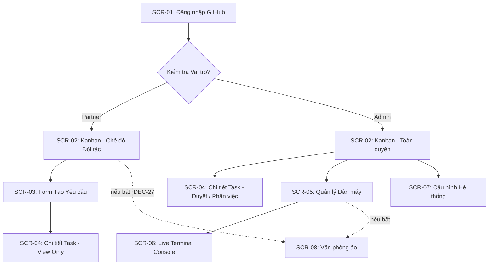

# 03. DANH SÁCH MÀN HÌNH & THIẾT KẾ GIAO DIỆN (SCREENS & UI)

---

## 1. BẢNG KIỂM KÊ MÀN HÌNH (SCREEN INVENTORY)

| Mã màn hình | Tên màn hình | Đối tượng sử dụng | Đường dẫn (Route) | File Component (Vite SPA) | DoD (Tiêu chuẩn hoàn thành) |
| :--- | :--- | :--- | :--- | :--- | :--- |
| **SCR-01** | Đăng nhập GitHub | Tất cả | `/login` | `src/pages/Login.tsx` | Nút đăng nhập GitHub OAuth, redirect mượt, lưu JWT cookie. |
| **SCR-02** | Bảng Kanban Điều phối | Tất cả (RBAC) | `/` hoặc `/kanban` | `src/pages/Kanban.tsx` | 5 cột: Backlog, Planning, In-Progress, QA/Review, Done. Drag-drop hoặc action buttons. |
| **SCR-03** | Form Tạo Yêu Cầu Mới | Tất cả | `/tasks/new` | `src/pages/TaskCreate.tsx` | Form nhập Tiêu đề, Mô tả mong muốn, Phạm vi, Upload ảnh mockup. |
| **SCR-04** | Chi Tiết Task & Lộ Trình | Tất cả | `/tasks/:id` | `src/pages/TaskDetail.tsx` | Hiển thị Issue gốc, danh sách Sub-tasks, PR liên kết, nút Duyệt (Admin). **Bổ sung FEAT-07:** tab "Làm rõ" (câu hỏi, trả lời, lịch sử vòng, "Cho trưởng phòng tự quyết"); **FEAT-10:** băng đề xuất huỷ của trưởng phòng AI, dùng được trên điện thoại. Design: SPEC_ONLY · Code: DONE (bổ sung FEAT-07/10: TODO) |
| **SCR-05** | Quản Trị Cụm Máy (Fleet) | Chỉ Admin | `/fleet` | `src/pages/Fleet.tsx` | Danh sách máy và agent: Tên, OS, kết nối, từng agent (Claude/Antigravity) với trạng thái IDLE/BUSY/COOLDOWN + đếm ngược, thẻ Lead (epoch, gia hạn), nút Trao/Thu hồi vai, drawer sửa ưu tiên & hạn mềm, nút xem Log (FEAT-01). **Bổ sung FEAT-06:** huy hiệu "Cần đăng nhập"/"Chưa kiểm được", băng `gh` chưa đăng nhập, nút "Đã đăng nhập, kiểm lại", công tắc lead + `lead_priority` cho mọi loại agent (DEC-29). Design: SPEC_ONLY · Code: DONE (gồm FEAT-06) |
| **SCR-06** | Live Terminal Console | Chỉ Admin | `/fleet/:id/terminal` | `src/pages/LiveTerminal.tsx` | Màn hình đen giả lập terminal (xterm.js), hiển thị ANSI logs real-time từ máy con. |
| **SCR-07** | Cài Đặt Hệ Thống | Chỉ Admin | `/settings` | `src/pages/Settings.tsx` | Công tắc "Bật văn phòng ảo" (FEAT-02); dòng chỉ đọc "Telegram: đang bật / tắt (cấu hình trong `.env`)" (DEC-30 — token/chat ID không sửa trên web). Code: DONE |
| **SCR-09** | Dự Án | Chỉ owner | `/projects` | `src/pages/Projects.tsx` | Danh sách dự án (repo, webhook, task mở, weight, max_parallel, lưu trữ) + repo chưa thêm (FEAT-04). **Bổ sung FEAT-09:** lệnh được phép, "Cần CI cho test tích hợp", dự án sandbox + Chạy thử dây chuyền. Design: SPEC_ONLY · Code: DONE (bổ sung FEAT-09: TODO) |
| **SCR-12** | Hồ Sơ | Mọi người dùng (token: chỉ owner) | `/profile` | `src/pages/Profile.tsx` | Thông tin GitHub; token cá nhân cho MCP (tạo, hiện một lần, thu hồi) + đoạn cấu hình `claude mcp add` (FEAT-10). Design: SPEC_ONLY · Code: TODO |
| **SCR-10** | Đóng Góp | Mọi người dùng (theo quyền) | `/contributions` | `src/pages/Contributions.tsx` | Tổng hợp theo partner/dự án + dòng thời gian (FEAT-05, DEC-21). Design: SPEC_ONLY · Code: DONE |
| **SCR-11** | Máy Của Tôi | Mọi người dùng | `/my/machines` | `src/pages/MyMachines.tsx` | Máy của mình, thêm máy (lệnh + hướng dẫn agent), tạm dừng/gỡ, chọn dự án (FEAT-05); huy hiệu đăng nhập + nút kiểm lại (FEAT-06). Design: SPEC_ONLY · Code: DONE (gồm FEAT-06) |
| **SCR-08** | Văn Phòng Ảo | Owner + Partner (khi bật, DEC-27) | `/office` | `src/pages/Office.tsx` | **Bản 2 (DEC-25 → DEC-28):** văn phòng hoàn chỉnh (tường, vách/cửa kính, sàn gỗ, bảng tin, cây xanh, phòng nghỉ, sảnh, logo INOVA); khu làm việc ≥ 8 bàn, hai cụm × hàng 2 bàn, lối đi giữa; bàn Trưởng phòng phía trên; khu chỉ huy mỗi tài khoản một bàn xếp dọc; 🔑 cho agent `NEEDS_AUTH` (FEAT-02). Design: SPEC_ONLY · Code: DONE (bản 2) |

---

## 2. SƠ ĐỒ ĐIỀU HƯỚNG MÀN HÌNH (SCREEN FLOWCHART)

---

## 3. BỐ CỤC 4 TRẠNG THÁI GIAO DIỆN (4-STATE UI PROTOCOL)

Tất cả các màn hình trên AgentHub đều bắt buộc cài đặt 4 trạng thái theo chuẩn UX:

1. **Empty State:**
   - Khi bảng Kanban hoặc danh sách Fleet chưa có dữ liệu: Hiển thị hình minh họa SVG nhẹ, tiêu đề *"Chưa có máy nào kết nối"* hoặc *"Chưa có tác vụ nào trong hàng đợi"* kèm nút hành động chính (Primary CTA) nổi bật (ví dụ: *"Thêm máy mới"* hoặc *"Tạo yêu cầu đầu tiên"*).
2. **Loading State:**
   - Tuyệt đối không dùng màn hình trắng trơn. Dùng Skeleton Loader (khung xương mô phỏng thẻ Kanban và dòng bảng) để giảm nhận thức thời gian chờ.
3. **Error State:**
   - Khi mất kết nối WebSocket hoặc gọi API thất bại: Hiển thị banner màu hổ phách/đỏ với thông điệp rõ ràng bằng tiếng Việt, kèm nút *"Thử lại"* (Retry) tự động phục hồi kết nối.
4. **Success State:**
   - Dữ liệu hiển thị trực quan, máy con hiển thị kết nối Online/Offline (Xanh lá, Xám mờ) và từng agent Idle/Busy/Cooldown (Xanh lá, Vàng cam, Tím kèm đếm ngược).

---

## 4. QUY TẮC FORM VALIDATION
* **Tiêu đề Yêu cầu (Task Title):** Bắt buộc, tối thiểu 6 ký tự, tối đa 120 ký tự.
* **Mô tả chi tiết:** Bắt buộc, hỗ trợ định dạng Markdown, tối thiểu 20 ký tự.
* **Tên Máy con (Runner Name):** Chỉ gồm chữ cái, số và dấu gạch ngang (regex: `^[a-zA-Z0-9-]+$`).
* **Ưu tiên lead:** số nguyên 1–99 hoặc để trống; mọi loại agent (DEC-29). **Hạn mềm:** `soft_max_jobs` 1–500 hoặc trống (tắt), `soft_window_hours` 1–24.

## 5. ĐIỀU HƯỚNG ĐA DỰ ÁN (FEAT-04)
Sidebar có ô chọn dự án; SCR-02/03/04 theo dự án đang chọn; mục quản trị (SCR-05, 07, 09) chỉ owner thấy (DEC-17); SCR-08 hiện cho cả partner khi bật (DEC-27). SCR-12 Hồ sơ ở menu người dùng cuối sidebar. Mọi màn chính dùng được ở 375px (DEC-40, BR-65). SCR-05 nhóm máy theo chủ (DEC-20); hộp thoại "Thêm máy" dùng chung SCR-05 và SCR-11.
