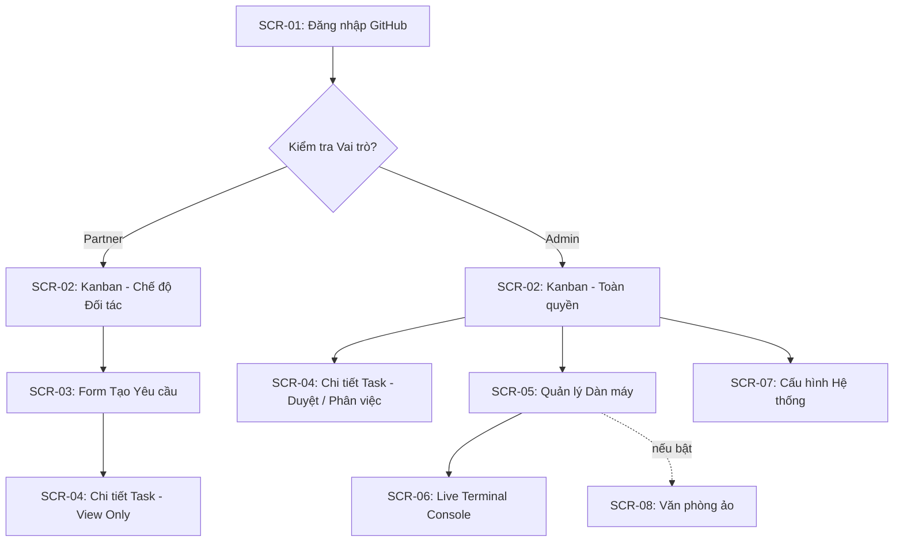

# 03. DANH SÁCH MÀN HÌNH & THIẾT KẾ GIAO DIỆN (SCREENS & UI)

---

## 1. BẢNG KIỂM KÊ MÀN HÌNH (SCREEN INVENTORY)

| Mã màn hình | Tên màn hình | Đối tượng sử dụng | Đường dẫn (Route) | File Component (Vite SPA) | DoD (Tiêu chuẩn hoàn thành) |
| :--- | :--- | :--- | :--- | :--- | :--- |
| **SCR-01** | Đăng nhập GitHub | Tất cả | `/login` | `src/pages/Login.tsx` | Nút đăng nhập GitHub OAuth, redirect mượt, lưu JWT cookie. |
| **SCR-02** | Bảng Kanban Điều phối | Tất cả (RBAC) | `/` hoặc `/kanban` | `src/pages/Kanban.tsx` | 5 cột: Backlog, Planning, In-Progress, QA/Review, Done. Drag-drop hoặc action buttons. |
| **SCR-03** | Form Tạo Yêu Cầu Mới | Tất cả | `/tasks/new` | `src/pages/TaskCreate.tsx` | Form nhập Tiêu đề, Mô tả mong muốn, Phạm vi, Upload ảnh mockup. |
| **SCR-04** | Chi Tiết Task & Lộ Trình | Tất cả | `/tasks/:id` | `src/pages/TaskDetail.tsx` | Hiển thị Issue gốc, danh sách Sub-tasks, PR liên kết, nút Duyệt (Admin). |
| **SCR-05** | Quản Trị Cụm Máy (Fleet) | Chỉ Admin | `/fleet` | `src/pages/Fleet.tsx` | Danh sách máy và agent: Tên, OS, kết nối, từng agent (Claude/Antigravity) với trạng thái IDLE/BUSY/COOLDOWN + đếm ngược, thẻ Lead (epoch, gia hạn), nút Trao/Thu hồi vai, drawer sửa ưu tiên & hạn mềm, nút xem Log (FEAT-01). Design: SPEC_ONLY · Code: DONE |
| **SCR-06** | Live Terminal Console | Chỉ Admin | `/fleet/:id/terminal` | `src/pages/LiveTerminal.tsx` | Màn hình đen giả lập terminal (xterm.js), hiển thị ANSI logs real-time từ máy con. |
| **SCR-07** | Cài Đặt Hệ Thống | Chỉ Admin | `/settings` | `src/pages/Settings.tsx` | Cấu hình Telegram Bot Token, Chat ID, GitHub Repo kết nối; công tắc "Bật văn phòng ảo" (FEAT-02). |
| **SCR-08** | Văn Phòng Ảo | Chỉ Admin (khi bật) | `/office` | `src/pages/Office.tsx` | Văn phòng pixel-art chỉ quan sát: dãy bàn theo máy, ghế Trưởng phòng theo lead, phòng nghỉ cho COOLDOWN, hoạt cảnh giao/nộp/review/chuyển giao (FEAT-02). Design: SPEC_ONLY · Code: DONE |

---

## 2. SƠ ĐỒ ĐIỀU HƯỚNG MÀN HÌNH (SCREEN FLOWCHART)

---

## 3. BỐ CỤC 4 TRẠNG THÁI GIAO DIỆN (4-STATE UI PROTOCOL)

Tất cả các màn hình trên AgentHub đều bắt buộc cài đặt 4 trạng thái theo chuẩn UX:

1. **Empty State:**
   - Khi bảng Kanban hoặc danh sách Fleet chưa có dữ liệu: Hiển thị hình minh họa SVG nhẹ, tiêu đề *"Chưa có máy nào kết nối"* hoặc *"Chưa có tác vụ nào trong hàng đợi"* kèm nút hành động chính (Primary CTA) nổi bật (ví dụ: *"Thêm máy mới"* hoặc *"Tạo yêu cầu đầu tiên"*).
2. **Loading State:**
   - Tuyệt đối không dùng màn hình trắng trơn. Dùng Skeleton Loader (khung xương mô phỏng thẻ Kanban và dòng bảng) để giảm nhận thức thời gian chờ.
3. **Error State:**
   - Khi mất kết nối WebSocket hoặc gọi API thất bại: Hiển thị banner màu hổ phách/đỏ với thông điệp rõ ràng bằng tiếng Việt, kèm nút *"Thử lại"* (Retry) tự động phục hồi kết nối.
4. **Success State:**
   - Dữ liệu hiển thị trực quan, máy con hiển thị kết nối Online/Offline (Xanh lá, Xám mờ) và từng agent Idle/Busy/Cooldown (Xanh lá, Vàng cam, Tím kèm đếm ngược).

---

## 4. QUY TẮC FORM VALIDATION
* **Tiêu đề Yêu cầu (Task Title):** Bắt buộc, tối thiểu 6 ký tự, tối đa 120 ký tự.
* **Mô tả chi tiết:** Bắt buộc, hỗ trợ định dạng Markdown, tối thiểu 20 ký tự.
* **Tên Máy con (Runner Name):** Chỉ gồm chữ cái, số và dấu gạch ngang (regex: `^[a-zA-Z0-9-]+$`).
* **Ưu tiên lead:** số nguyên 1–99 hoặc để trống; chỉ agent Claude. **Hạn mềm:** `soft_max_jobs` 1–500 hoặc trống (tắt), `soft_window_hours` 1–24.
