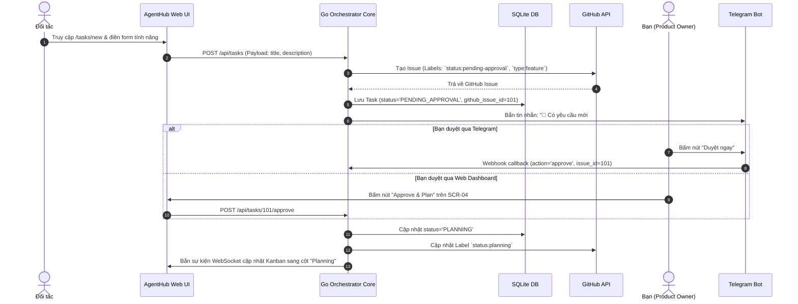
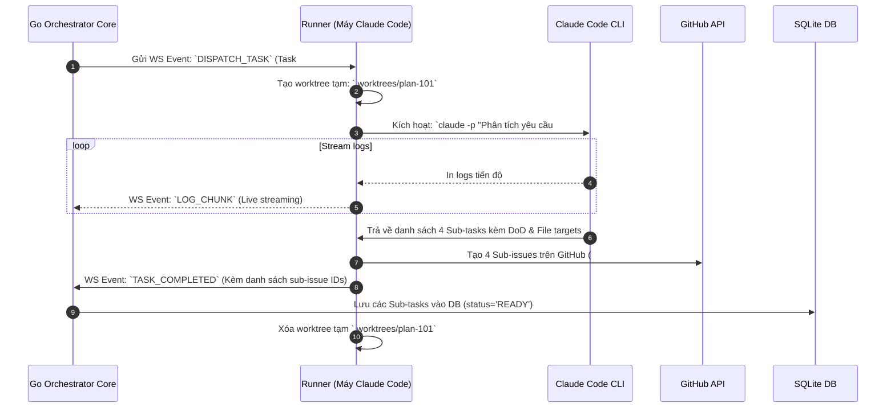
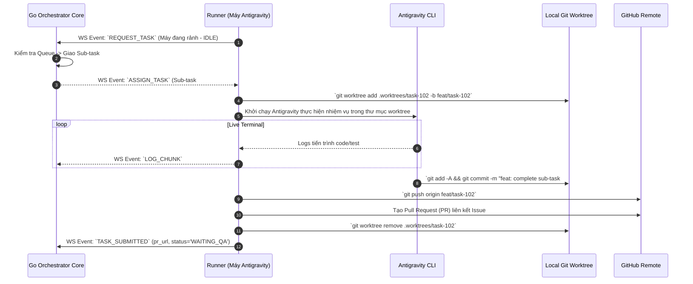

# 04. LUỒNG DI CHUYỂN NGƯỜI DÙNG & TÁC NHÂN (USER FLOWS)

---

## 1. LUỒNG 1: ĐỐI TÁC TẠO YÊU CẦU & BẠN PHÊ DUYỆT (FEATURE INTAKE & APPROVAL)

---

## 2. LUỒNG 2: CLAUDE CODE LẬP KẾ HOẠCH & BẺ NHỎ TÁC VỤ (PLANNING FLOW)

---

## 3. LUỒNG 3: DÀN MÁY ANTIGRAVITY THI CÔNG PHÂN TÁN (EXECUTION FLOW)

---

## 4. LUỒNG 4: KIỂM ĐỊNH CHẤT LƯỢNG 2 LỚP & XUẤT BẢN (QA & MERGE)

1. **Lớp 1 (GitHub Actions CI):** Tự động kích hoạt khi PR được mở. Chạy build, lint, unit tests. Nếu fail -> Gắn label `ci:failed` -> Server tự giao lại task cho Antigravity sửa lỗi.
2. **Lớp 2 (Claude Code AI Review):** Nếu CI passed -> Server giao PR cho máy Claude Code kéo về review logic, bảo mật.
   - Nếu đạt: Claude comment review và gắn nhãn `qa-passed`.
   - Nếu chưa đạt: Claude comment chi tiết các điểm cần refactor.
3. **Xuất bản (Release):** Server bắn tin Telegram cho Bạn: *"PR #15 cho Task #101 đã QA Passed"*. Bạn bấm nút **Merge** trên Dashboard -> Code được gộp vào `main` và tính năng được đóng gói bàn giao.

---

## 5. LUỒNG 5: CHUYỂN GIAO KHI HẾT LIMIT & LUÂN CHUYỂN TRƯỞNG PHÒNG

Chi tiết sơ đồ ở [features/lead-rotation.md](features/lead-rotation.md) mục 3. Tóm tắt:
1. **Agent hết limit giữa job:** Runner commit WIP + push nhánh, sinh `handoff_note`, gửi `AGENT_EXHAUSTED` → agent `COOLDOWN`; job về hàng đợi (`attempt + 1`); agent `IDLE` khác nhận, checkout cùng nhánh, làm tiếp.
2. **Lead hết limit / mất kết nối / hết hạn lease:** Server tăng `epoch`, trao lease cho agent Claude `IDLE` kế tiếp (BR-06), ghi `lead_journal`, báo Telegram. Lead cũ gửi lệnh với `epoch` cũ bị từ chối.
3. **Không còn Claude:** chế độ trống lead — job code vẫn chạy, việc trí tuệ chờ; Claude đầu tiên hết cooldown tự nhận lease.
4. **Admin can thiệp:** trao/thu hồi vai trên SCR-05.
