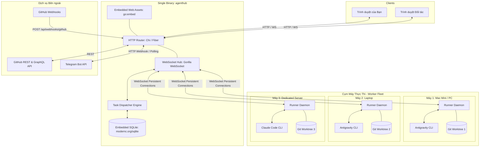
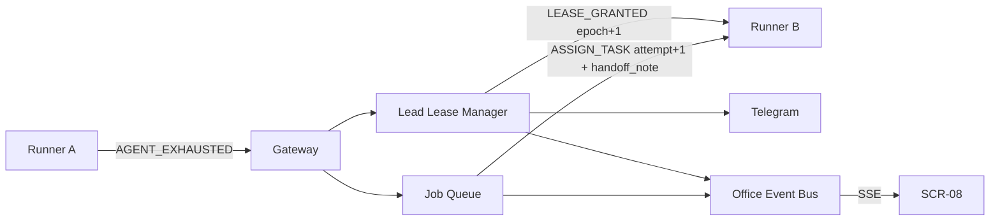

# 05. KIẾN TRÚC KỸ THUẬT TOÀN DIỆN (SYSTEM ARCHITECTURE)

---

## 1. TỔNG QUAN KIẾN TRÚC VẬT LÝ & TIẾN TRÌNH



---

## 2. NGUYÊN LÝ SINGLE BINARY (GO:EMBED)

Để đạt tiêu chí "nhẹ nhất và ổn nhất", AgentHub loại bỏ hoàn toàn các phụ thuộc phức tạp (Docker daemon, Nginx reverse proxy, Node.js server):

1. **Frontend Compilation:** Frontend React/Vite được build ra thư mục tĩnh `/web/dist`.
2. **Go Embedding:** File `cmd/server/main.go` sử dụng chỉ thị:
   ```go
   //go:embed all:web/dist
   var embeddedFrontend embed.FS
   ```
3. **Zero CGO SQLite:** Sử dụng package `modernc.org/sqlite` (trình biên dịch C sang thuần Go), cho phép biên dịch chéo (cross-compile) ra file nhị phân chạy trên Linux/macOS/Windows mà không cần cài gcc hay thư viện C.
4. **Kết quả:** File `agenthub` kích thước khoảng ~20MB, khởi động trong 10 mili-giây, chiếm ~20MB RAM khi chạy.

---

## 3. CƠ CHẾ KẾT NỐI WEBSOCKET & QUẢN LÝ FLEET

* **Heartbeat & Ping-Pong:** Mỗi máy con gửi `PING` 15 giây một lần. Quá 45 giây không nhận → máy `OFFLINE` (hiển thị). `OFFLINE` liên tục 120 giây → thu hồi các assignment đang chạy (FEAT-01 BR-13). Hai ngưỡng này độc lập nhau.
* **Máy và Agent (DEC-04):** Mỗi máy khai báo danh sách agent khi bắt tay (`agents: [{kind: CLAUDE}, {kind: ANTIGRAVITY}]`). Mỗi agent có trạng thái riêng `IDLE | BUSY | COOLDOWN`; một agent tối đa một job.
* **Job Queue & định tuyến:** Mọi việc là job (`SPEC`, `CODE`, `QA_REVIEW`, `REPLAN`, `UNBLOCK`, dành sẵn `DESIGN`, `TEST_WRITE`), mỗi job khai `required_agent`. Việc trí tuệ → agent `CLAUDE`; việc code → agent `ANTIGRAVITY`.
* **Buffer Streaming Logs:** Log console từ máy con không gửi từng ký tự lẻ mà được buffer theo cửa sổ 100ms hoặc khi đủ 1KB để tiết kiệm băng thông mạng và tránh giật lag trình duyệt.

---

## 4. TRƯỞNG PHÒNG TRỰC & CHUYỂN GIAO (FEAT-01)

* **Server là bộ điều phối duy nhất** (DEC-01): code Go, không tiêu token, không bao giờ hết limit → không cần bầu chọn phân tán. Điểm hỏng duy nhất này chấp nhận ở v1; chạy trên máy luôn bật/VPS và sao lưu `agenthub.db` định kỳ.
* **Lead Lease Manager** (`internal/dispatcher/lease.go`): giữ bản ghi `lead_lease` (`epoch`, `expires_at`, TTL 90 giây, gia hạn 30 giây). Mọi đổi lead trong một transaction và tăng `epoch`.
* **Fencing:** `assignment_id` cho mỗi lần giao job, `epoch` cho mỗi đời lead; bản tin mang mã cũ bị từ chối.
* **Phát hiện hết limit ở Runner:** so stderr của CLI với `exhaust_patterns`; commit WIP + push trước khi báo `AGENT_EXHAUSTED`.
* **Trạng thái điều phối nằm ở DB** (`jobs`, `assignments`, `lead_journal`), không nằm trong context của phiên Claude → lead mới đọc là làm tiếp được.



## 5. VĂN PHÒNG ẢO (FEAT-02)

* `internal/office`: nhận sự kiện miền từ Dispatcher/Lease Manager/GitHub sync, chuyển sang OfficeEvent, giữ bộ đệm vòng 400 sự kiện trong RAM, phát qua SSE `GET /api/admin/office/stream`. Không lưu DB, không thêm tiến trình, không cần cài gì trên máy con.
