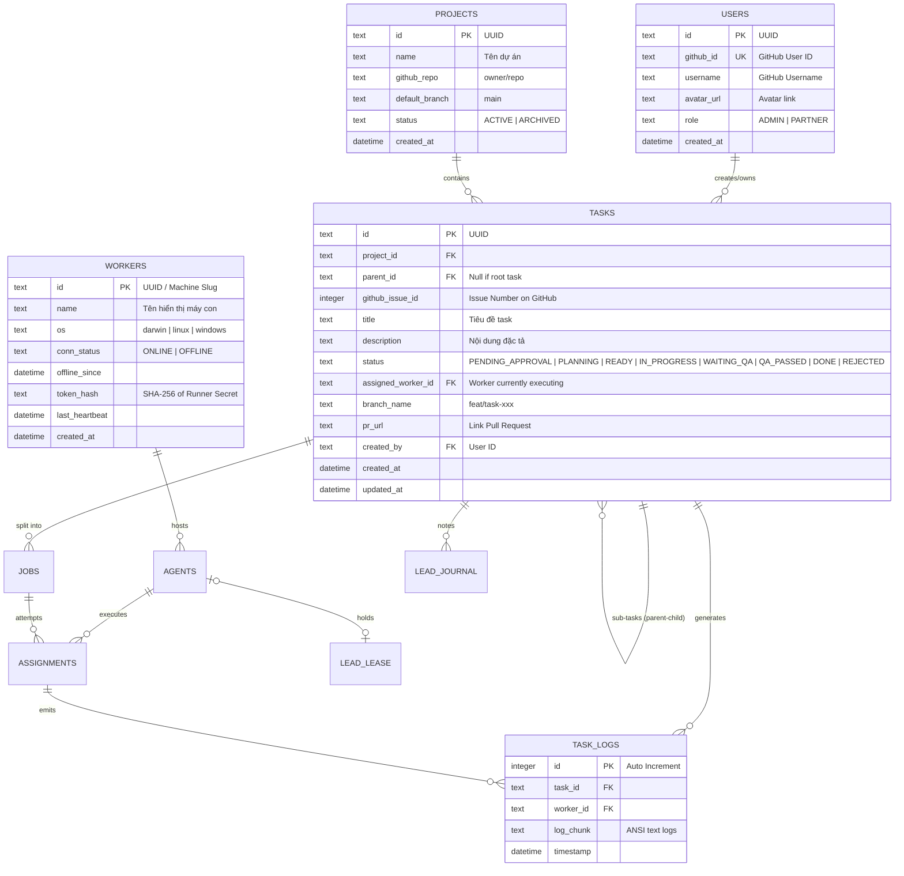

# 06. THIẾT KẾ CƠ SỞ DỮ LIỆU SQLITE (DATABASE SCHEMA)

---

## 1. SƠ ĐỒ THỰC THỂ QUAN HỆ (ERD)



---

## 2. DDL SQLITE DEFINITIONS

```sql
-- Bảng USERS
CREATE TABLE IF NOT EXISTS users (
    id TEXT PRIMARY KEY,
    github_id TEXT UNIQUE NOT NULL,
    username TEXT NOT NULL,
    avatar_url TEXT,
    role TEXT NOT NULL CHECK(role IN ('ADMIN', 'PARTNER')),
    created_at DATETIME DEFAULT CURRENT_TIMESTAMP
);

-- Bảng PROJECTS
CREATE TABLE IF NOT EXISTS projects (
    id TEXT PRIMARY KEY,
    name TEXT NOT NULL,
    github_repo TEXT NOT NULL UNIQUE,
    default_branch TEXT NOT NULL DEFAULT 'main',
    status TEXT NOT NULL DEFAULT 'ACTIVE' CHECK(status IN ('ACTIVE', 'ARCHIVED')),
    created_at DATETIME DEFAULT CURRENT_TIMESTAMP
);

-- Bảng WORKERS (Máy con)
CREATE TABLE IF NOT EXISTS workers (
    id TEXT PRIMARY KEY,
    name TEXT NOT NULL,
    os TEXT NOT NULL,
    conn_status TEXT NOT NULL DEFAULT 'OFFLINE' CHECK(conn_status IN ('ONLINE', 'OFFLINE')),
    offline_since DATETIME,
    token_hash TEXT NOT NULL,
    last_heartbeat DATETIME,
    created_at DATETIME DEFAULT CURRENT_TIMESTAMP
);

-- Bảng TASKS
CREATE TABLE IF NOT EXISTS tasks (
    id TEXT PRIMARY KEY,
    project_id TEXT NOT NULL REFERENCES projects(id) ON DELETE CASCADE,
    parent_id TEXT REFERENCES tasks(id) ON DELETE CASCADE,
    github_issue_id INTEGER,
    title TEXT NOT NULL,
    description TEXT NOT NULL,
    status TEXT NOT NULL DEFAULT 'PENDING_APPROVAL' 
        CHECK(status IN ('PENDING_APPROVAL', 'PLANNING', 'READY', 'IN_PROGRESS', 'WAITING_QA', 'QA_PASSED', 'DONE', 'REJECTED')),
    assigned_worker_id TEXT REFERENCES workers(id) ON DELETE SET NULL,
    branch_name TEXT,
    pr_url TEXT,
    created_by TEXT NOT NULL REFERENCES users(id),
    created_at DATETIME DEFAULT CURRENT_TIMESTAMP,
    updated_at DATETIME DEFAULT CURRENT_TIMESTAMP
);

CREATE INDEX IF NOT EXISTS idx_tasks_status ON tasks(status);
CREATE INDEX IF NOT EXISTS idx_tasks_parent ON tasks(parent_id);
CREATE INDEX IF NOT EXISTS idx_tasks_assigned_worker ON tasks(assigned_worker_id);

-- Bảng TASK_LOGS (Lưu logs gần nhất)
CREATE TABLE IF NOT EXISTS task_logs (
    id INTEGER PRIMARY KEY AUTOINCREMENT,
    task_id TEXT NOT NULL REFERENCES tasks(id) ON DELETE CASCADE,
    worker_id TEXT NOT NULL REFERENCES workers(id),
    assignment_id TEXT REFERENCES assignments(id),  -- lần thử nào (FEAT-01)
    log_chunk TEXT NOT NULL,
    timestamp DATETIME DEFAULT CURRENT_TIMESTAMP
);

CREATE INDEX IF NOT EXISTS idx_task_logs_task ON task_logs(task_id);
```

---

### 2.1 Bảng bổ sung (FEAT-01, FEAT-02)
DDL đầy đủ nằm ở [features/lead-rotation.md](features/lead-rotation.md) mục 5 và [features/virtual-office.md](features/virtual-office.md) mục 5; `schema.sql` phải gộp đủ:

| Bảng | Mục đích |
| :--- | :--- |
| `agents` | Từng CLI trên máy: `kind`, `status IDLE/BUSY/COOLDOWN`, `cooldown_until`, `lead_priority`, hạn mềm |
| `jobs` | Hàng đợi việc: `kind` (SPEC/DESIGN/TEST_WRITE/CODE/QA_REVIEW/REPLAN/UNBLOCK), `required_agent`, `lead_only`, `priority`, `attempt`, `project_id` |
| `assignments` | Mỗi lần giao job cho agent; `id` là mã fencing; `handoff_note`, `wip_commit` |
| `lead_lease` | Đúng 1 dòng: `state HELD/VACANT`, `agent_id`, `epoch`, `expires_at` |
| `lead_journal` | Nhật ký bàn giao/quyết định của lead |
| `settings` | Cài đặt hệ thống key-value (`office_enabled`, …) |

`tasks.assigned_worker_id` chỉ còn để hiển thị; nguồn sự thật là `jobs.current_assignment_id → assignments.agent_id`.

## 3. CHÍNH SÁCH DỌN DẸP DỮ LIỆU LOGS (LOG ROTATION)
Bảng `task_logs` chỉ lưu giữ tối đa 5000 dòng log gần nhất cho mỗi task đang chạy. Sau khi task chuyển sang trạng thái `DONE`, các bản ghi log chi tiết sẽ được xuất nén thành file text lưu trữ cục bộ và xóa khỏi bảng SQLite để giữ cho file database luôn nhỏ gọn (< 50MB).
