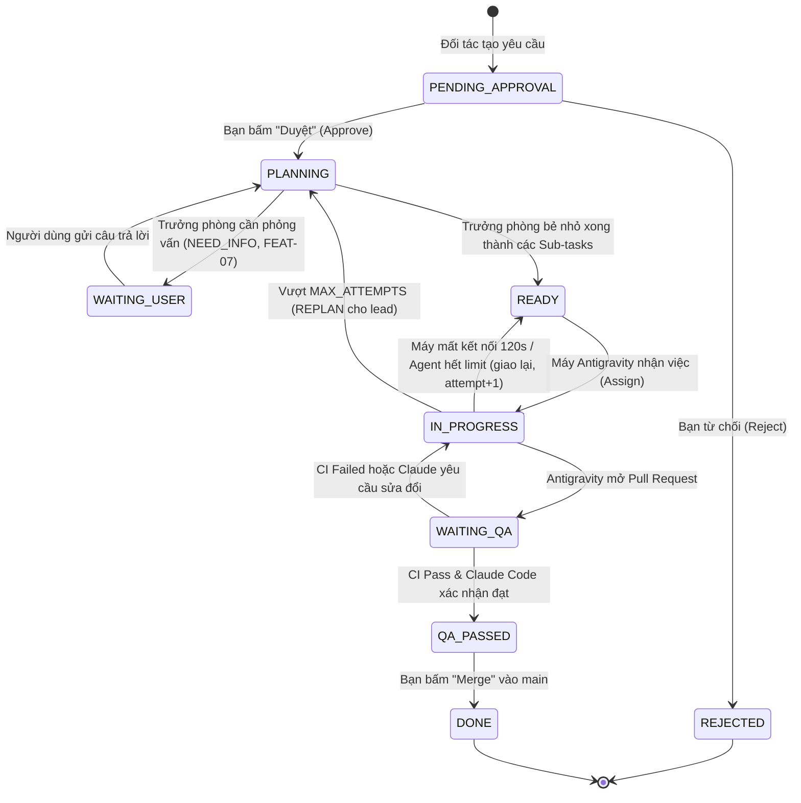

# 12. QUY TẮC NGHIỆP VỤ & MÁY TRẠNG THÁI (BUSINESS RULES)

---

## 1. MÁY TRẠNG THÁI CỦA TÁC VỤ (TASK STATE MACHINE)

Mỗi tác vụ (Task/Issue) trong hệ thống đều trải qua một vòng đời nghiêm ngặt và không được phép nhảy cóc trạng thái:

### Bảng Điều kiện Chuyển trạng thái (Transition Guards)

| Trạng thái Nguồn | Trạng thái Đích | Người/Tác nhân kích hoạt | Điều kiện kiểm tra (Guard Condition) |
| :--- | :--- | :--- | :--- |
| `PENDING_APPROVAL` | `PLANNING` | Bạn (Admin) | Chỉ Admin mới có quyền duyệt; Issue phải có tiêu đề và mô tả hợp lệ. |
| `PENDING_APPROVAL` | `REJECTED` | Bạn (Admin) | Phải kèm theo lý do từ chối để thông báo cho đối tác. |
| `PLANNING` | `WAITING_USER` | Agent làm job SPEC (Runner) | `result.json` có `status = NEED_INFO` hợp lệ, `round ≤ 3` (FEAT-07, BR-47, BR-48). REPLAN `ask_user` cũng vào đây (BR-64). |
| `WAITING_USER` | `PLANNING` | Người dùng (User) | Gửi câu trả lời qua Web/GitHub/Telegram; nạp câu trả lời vào job SPEC tiếp theo. |
| `PLANNING` | `READY` | Trưởng phòng (Runner) | Phải tạo thành công ít nhất 1 Sub-issue trên GitHub kèm checklist DoD. |
| `READY` | `IN_PROGRESS` | Task Dispatcher | Có ít nhất 1 agent `ANTIGRAVITY` ở trạng thái `IDLE`, `auth_status <> NEEDS_AUTH`, trên máy `ONLINE`, không `paused`, `gh_auth <> NEEDS_AUTH` (BR-37). |
| `IN_PROGRESS` | `WAITING_QA` | Antigravity (Runner) | Đã push code lên branch và mở thành công PR trên GitHub. |
| `IN_PROGRESS` | `READY` | Hệ thống (Timeout Engine) | Máy `OFFLINE` liên tục 120s (BR-13), hoặc agent gửi `AGENT_EXHAUSTED` hợp lệ (BR-08), hoặc `AGENT_AUTH NEEDS_AUTH` kèm `assignment_id` (BR-39 — **không** tăng `attempt`). Không có log 15 phút **không** thu hồi mà sinh job `UNBLOCK` (BR-16). |
| `IN_PROGRESS` | `PLANNING` | Hệ thống | `attempt > MAX_ATTEMPTS` (3) → job `REPLAN` cho lead (BR-15). |
| `WAITING_QA` | `QA_PASSED` | Claude Code (QA Lead) | GitHub Actions CI trả về `success` và Claude Code gắn tag review hợp lệ. |
| `QA_PASSED` | `DONE` | Bạn (Admin) | PR đã được gộp (Merged) thành công vào nhánh chính `main`. |

---

## 2. QUY TẮC RÀNG BUỘC CỦA CỤM MÁY CON (WORKER FLEET RULES)

1. **Ràng buộc Một việc tại một thời điểm (One-Job-Per-Agent):** Mỗi agent (một CLI trên một máy) chỉ có tối đa 1 job đang chạy (DEC-04, BR-17). Một máy có cả Claude và Antigravity có thể chạy song song 2 job.
2. **Cơ chế Thu hồi Tác vụ (Task Reclaim & Failover):**
   - 45 giây không có `PING` → máy `OFFLINE` (chỉ hiển thị, chưa thu hồi).
   - `OFFLINE` liên tục 120 giây → mọi assignment đang chạy của máy thành `RECLAIMED`, job về hàng đợi với `attempt + 1`; máy rảnh khác nhận và làm tiếp từ commit đã push gần nhất.
   - Máy cũ kết nối lại và gửi bản tin mang `assignment_id` cũ → bị từ chối `STALE_ASSIGNMENT` (BR-04).
3. **Quy tắc Dọn dẹp Worktree (Clean-up Guarantee):**
   - Trước khi nhận task mới, Runner bắt buộc phải chạy lệnh kiểm tra dọn dẹp các thư mục worktree cũ để tránh rò rỉ dung lượng ổ cứng.
4. **Quy tắc trưởng phòng trực & hết limit:** BR-01 → BR-18 ở [features/lead-rotation.md](features/lead-rotation.md) mục 7 (lease, epoch, chọn lead, trống lead, hạn mềm, cooldown, bàn giao WIP).
5. **Quy tắc văn phòng ảo:** BR-19 → BR-23 (BR-23 sửa ở bản 2) và BR-43 → BR-46 ở [features/virtual-office.md](features/virtual-office.md) mục 7.
6. **Đa dự án & máy của partner:** BR-24 → BR-36 ở [features/multi-project.md](features/multi-project.md) §7 và [features/join-machine.md](features/join-machine.md) §7.
7. **Trạng thái đăng nhập & lead mọi loại agent:** BR-37 → BR-42 ở [features/agent-auth.md](features/agent-auth.md) §7 (máy trạng thái `auth_status`). BR-42 thay một phần BR-06/BR-07 (DEC-29).
8. **Phỏng vấn làm rõ & kỹ năng dùng chung:** BR-47 → BR-55 ở [features/clarification-and-shared-skills.md](features/clarification-and-shared-skills.md) §7 (BR-50, BR-52 đã sửa theo DEC-32/33).
9. **Vận hành thật & đa partner:** BR-56 → BR-60 ở [features/ops-readiness.md](features/ops-readiness.md) §7. BR-58 bổ sung điều kiện nhận việc của BR-37.
10. **Điều hành mọi nơi:** BR-61 → BR-65 ở [features/remote-command.md](features/remote-command.md) §7. BR-64 thay hành vi REPLAN/UNBLOCK cũ (kết quả bị bỏ qua).
