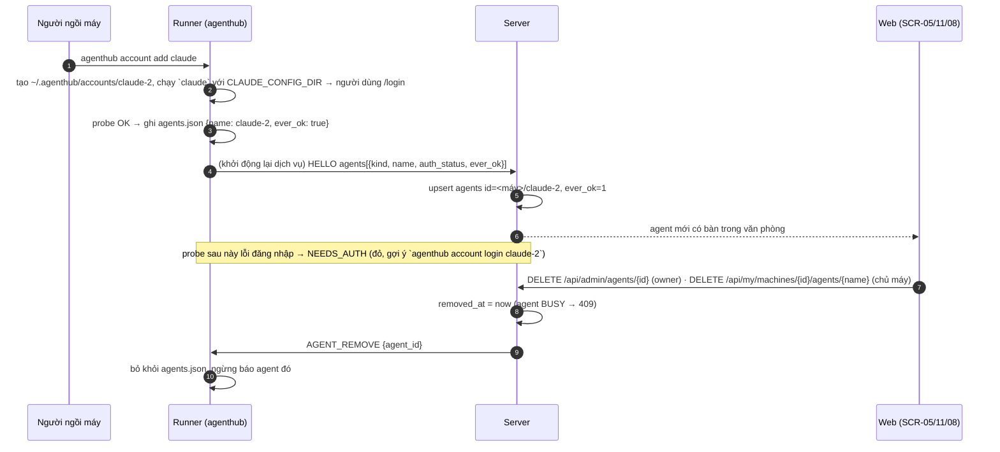

# FEAT-11: Tài khoản agent linh động theo máy

> Trạng thái: SPEC_APPROVED (2026-11-05) · Quyết định: DEC-41, DEC-42, DEC-43 · Sửa FEAT-05 (join máy), FEAT-06 (trạng thái đăng nhập)

## 1. Tổng quan & mục tiêu nghiệp vụ

**Bài toán (chạy thật 2026-11-05):**
- Máy nào có cài CLI là `install.sh` đăng ký luôn agent đó, kể cả khi CLI chưa có tài khoản. Ví dụ `macbook-nam/claude` báo `NEEDS_AUTH` "Not logged in" dù chưa bao giờ dùng, trông như lỗi.
- Mỗi máy tối đa một agent cho mỗi loại (`UNIQUE(worker_id, kind)`, id `<máy>/claude`). Máy có 3 tài khoản Claude chỉ dùng được 1.
- Không có cách bỏ một agent khỏi hub.

**Mục tiêu:**
- **Agent = một tài khoản CLI.** Một máy có thể có 0..n agent mỗi loại, mỗi agent có thư mục cấu hình riêng.
- Agent chỉ xuất hiện trên hub sau lần đăng nhập thành công đầu tiên. Chỉ agent từng OK rồi mất phiên mới báo "Cần đăng nhập lại".
- Owner và chủ máy xoá được agent trên web; runner gỡ agent đó khỏi cấu hình nên không tự đăng ký lại.

**Ngoài phạm vi:** thêm tài khoản từ web (vẫn phải đăng nhập trên chính máy đó); chia hạn mức giữa các tài khoản; loại agent mới ngoài `CLAUDE`/`ANTIGRAVITY`.

## 2. Phân quyền

| Hành động | Owner | Chủ máy (PARTNER) | Khác |
| :--- | :---: | :---: | :---: |
| `agenthub account add/remove/list/login` trên máy | — (chạy tại máy) | — (chạy tại máy) | — |
| Xoá agent trên web (SCR-05 Cụm máy) | ✅ mọi máy | ❌ | ❌ |
| Xoá agent trên web (SCR-11 Máy của tôi) | ✅ | ✅ máy của mình | ❌ |
| Thấy agent chưa từng OK | ❌ (ẩn ở mọi màn) | ❌ | ❌ |

## 3. Luồng tương tác



## 4. Giao diện & 4 trạng thái UI

**SCR-05 Cụm máy / SCR-11 Máy của tôi:** mỗi máy liệt kê đúng các agent đang có (0..n mỗi loại), mỗi dòng: tên tài khoản (`claude-2`), loại, trạng thái, đăng nhập.
- `NEEDS_AUTH` (đã từng OK): huy hiệu đỏ "Cần đăng nhập lại" + lệnh gợi ý `agenthub account login <name>` + nút **Xoá**.
- Nút **Xoá** (owner ở SCR-05; owner/chủ máy ở SCR-11): hộp xác nhận "Xoá tài khoản <id> khỏi hub? Máy sẽ không tự đăng ký lại." Agent BUSY → nút disabled, tooltip "Đang chạy việc".
- Máy không còn agent nào: dòng xám "Chưa có tài khoản agent — chạy `agenthub account add claude` trên máy này".

| Trạng thái | Hiển thị |
| :--- | :--- |
| Loading | skeleton như cũ |
| Empty | máy không có agent → dòng hướng dẫn ở trên |
| Error | xoá lỗi → banner `role=alert` kèm message server (409 "agent đang chạy việc") |
| Success | xoá xong → dòng biến mất, không tải lại cả trang |

**SCR-08 Văn phòng:** chỉ vẽ bàn cho agent đang có (bỏ "tối thiểu 8 chỗ", sửa DEC-25 → DEC-44). Agent chưa từng OK không có bàn.

## 5. Tác động dữ liệu — migration `006_agent_accounts.sql`

Dựng lại bảng `agents` (marker `-- agenthub:foreign_keys=off` như 005):

```diff
 CREATE TABLE agents (
     id TEXT PRIMARY KEY,                    -- "<worker_id>/<name>"
     worker_id TEXT NOT NULL REFERENCES workers(id) ON DELETE CASCADE,
     kind TEXT NOT NULL CHECK(kind IN ('CLAUDE', 'ANTIGRAVITY')),
+    name TEXT,                              -- [a-z0-9-]{1,32}; trigger AFTER INSERT điền = phần sau '/' của id khi NULL
     ... (giữ nguyên các cột cũ) ...
+    ever_ok INTEGER NOT NULL DEFAULT 1,     -- 0 = chưa từng đăng nhập OK (HELLO báo ever_ok=false, hoặc join máy mới chưa probe)
+    removed_at DATETIME,                    -- tombstone: đã xoá, HELLO bỏ qua id này
-    UNIQUE(worker_id, kind)
+    UNIQUE(worker_id, name)
 );
```

Dữ liệu cũ: `name` = phần sau `/` của `id`; `ever_ok = 1` nếu `auth_status = 'OK'` **hoặc** agent đã từng có assignment (agy có thể `UNKNOWN` mà vẫn chạy việc được). Agent `ever_ok = 0` vẫn giữ trong DB nhưng bị ẩn.

**Runner — `~/.agenthub/agents.json`** (mới, quyền 0600):
```json
{"agents": [
  {"name": "claude", "kind": "CLAUDE", "command": ["claude","-p","{prompt}"], "config_dir": "", "ever_ok": true},
  {"name": "claude-2", "kind": "CLAUDE", "command": ["claude","-p","{prompt}"], "config_dir": "~/.agenthub/accounts/claude-2", "ever_ok": true}
]}
```
`config_dir` rỗng = tài khoản mặc định của người dùng. Có `config_dir`: CLAUDE chạy với `CLAUDE_CONFIG_DIR=<dir>`, ANTIGRAVITY chạy với `HOME=<dir>`. Cờ `--agent kind=lệnh` cũ vẫn nhận được (name = kind viết thường) khi không có `agents.json`.

## 6. Hợp đồng API

| Phương thức | Đường dẫn | Mô tả |
| :--- | :--- | :--- |
| WS (runner→server) | `HELLO` `data.agents[]` | thêm `name` (tuỳ chọn, mặc định = kind viết thường), `ever_ok` (bool). Server bỏ qua phần tử có id đã `removed_at`. |
| WS (server→runner) | `AGENT_REMOVE` `{agent_id}` | runner gỡ agent khỏi `agents.json` và khỏi danh sách đang chạy. Gửi ngay khi xoá nếu máy online, và gửi lại sau `HELLO` cho mọi id tombstone mà runner còn báo. |
| DELETE | `/api/admin/agents/{id}` | owner (ADMIN) → `200 {"removed": "<id>"}`; agent có assignment ACTIVE → `409 CONFLICT`; không phải ADMIN → `403`; không có/đã xoá → `404`. Agent đang giữ lead → nhả lease trước (như REVOKE). |
| DELETE | `/api/my/machines/{id}/agents/{name}` | chủ máy (hoặc owner) xoá agent `<id>/<name>` của máy mình; mã lỗi như trên (`dispatcher.ErrConflict` → 409), máy không thuộc người gọi → `403`. |
| GET | `/api/fleet`, `/api/my/machines`, `/api/office/stream` | chỉ trả agent `ever_ok = 1 AND removed_at IS NULL`; mỗi agent thêm `name`. |

## 7. Quy tắc nghiệp vụ (BR-66 → BR-70)

| Mã | Quy tắc |
| :--- | :--- |
| **BR-66** | Agent id = `<worker_id>/<name>`, `name` khớp `^[a-z0-9][a-z0-9-]{0,31}$`, duy nhất trong máy. Mặc định `name` = kind viết thường (tương thích id cũ). `account add` chọn tên kế tiếp chưa dùng (`claude-2`, `claude-3`…), không tái dùng tên đã xoá trên máy đó. |
| **BR-67** | Runner chỉ báo agent trong `HELLO` khi `ever_ok = true`. `ever_ok` bật khi probe đăng nhập OK hoặc một job của agent hoàn tất. `install.sh` chỉ ghi vào `agents.json` CLI đã probe OK. |
| **BR-68** | Server: `ever_ok` đã là 1 thì không bao giờ về 0. Dispatcher không giao việc cho agent `ever_ok = 0`, `removed_at` khác NULL hoặc `NEEDS_AUTH`. |
| **BR-69** | Xoá agent: chỉ khi không có assignment ACTIVE; đặt `removed_at`, nhả lead nếu đang giữ, gửi `AGENT_REMOVE`. `HELLO` sau đó còn báo id này → bỏ qua và gửi lại `AGENT_REMOVE`. |
| **BR-70** | Nhiều agent cùng loại trên một máy chạy song song độc lập, mỗi agent một slot, hạn mức và cooldown riêng (COOLDOWN của `claude` không chặn `claude-2`). |

## 8. Test case (TC-97 → TC-103)

| Mã | Loại | Kịch bản | Kỳ vọng |
| :--- | :--- | :--- | :--- |
| **TC-97** | Migration | DB có `m/claude` OK, `m/antigravity` UNKNOWN có assignment, `x/claude` NEEDS_AUTH chưa từng chạy | Sau 006: `name` đúng; `ever_ok` = 1, 1, 0; FK sạch; chèn được `m/claude-2` cùng kind |
| **TC-98** | Dispatcher | HELLO 2 agent CLAUDE `claude`, `claude-2` | 2 hàng, 2 slot nhận việc độc lập; COOLDOWN một cái không chặn cái kia |
| **TC-99** | Dispatcher | HELLO có agent `ever_ok=false`; agent đã `removed_at` | Không tạo hàng mới / không hồi sinh; trả danh sách cần `AGENT_REMOVE` |
| **TC-100** | API | DELETE agent: owner OK; chủ máy OK; partner khác 403; BUSY 409; đang giữ lead → nhả lease | Đúng mã; fleet/office không còn agent |
| **TC-101** | Runner | `agents.json` 2 tài khoản CLAUDE với `config_dir` | Lệnh chạy có `CLAUDE_CONFIG_DIR` đúng; agy có `HOME` đúng; HELLO chỉ gồm `ever_ok` |
| **TC-102** | Runner | Nhận `AGENT_REMOVE` | Ghi lại `agents.json` không còn agent; không báo trong HELLO kế tiếp |
| **TC-103** | Web | SCR-05/SCR-11: NEEDS_AUTH đỏ + lệnh gợi ý; Xoá → DELETE + dòng biến mất; 409 → alert; máy không agent → dòng hướng dẫn | vitest |

## 9. Task triển khai & DoD

| Task | Nội dung | Xác minh |
| :--- | :--- | :--- |
| **TASK-049** | Server: migration 006, dispatcher HELLO theo `name`/`ever_ok`/tombstone, BR-68/70, DELETE agent + `AGENT_REMOVE`, lọc fleet/office | TC-97 → TC-100, `go test ./internal/... -race` |
| **TASK-050** | Runner: `agents.json`, `agenthub account add/remove/list/login`, env theo `config_dir`, `ever_ok`, xử lý `AGENT_REMOVE`; `install.sh` chỉ ghi CLI đã OK | TC-101, TC-102, test `install.sh` |
| **TASK-051** | Web SCR-05/SCR-11 (xoá, NEEDS_AUTH, dòng hướng dẫn) + văn phòng bản 3 (FEAT-02 §10, DEC-44) | TC-103 + vitest office + kiểm tay bằng ảnh chụp |
