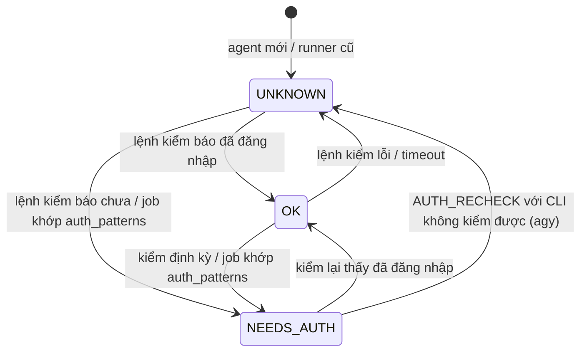

# FEAT-06: Trạng thái đăng nhập của agent & trưởng phòng mọi loại agent

> Trạng thái: SPEC_APPROVED (2026-11-04) · Quyết định: DEC-22, DEC-23, DEC-24, DEC-29, DEC-30

## 1. Tổng quan & mục tiêu nghiệp vụ

**Bài toán:** Trạng thái `IDLE` hiện chỉ có nghĩa "binary có trên PATH và runner đang kết nối". Agent chưa đăng nhập (`claude` chưa `/login`, `gh` chưa `auth login`, `agy` chưa đăng nhập) vẫn hiện IDLE, vẫn được giao job và được chọn làm lead, đến khi chạy mới lỗi. Ngoài ra vai trưởng phòng đang khoá cứng cho Claude (DEC-05), trong khi Admin muốn chỉ định cả Antigravity tiếp quản khi cần.

**Mục tiêu:**
1. Server biết chính xác agent nào đã đăng nhập, agent nào cần người đăng nhập; dispatcher và bộ chọn lead bỏ qua agent `NEEDS_AUTH`.
2. Owner/chủ máy thấy ngay trên SCR-05, SCR-11, SCR-08 và qua Telegram, kèm lệnh cần chạy.
3. Agent bất kỳ (Claude hoặc Antigravity) giữ được vai trưởng phòng nếu Admin bật `lead_eligible` (DEC-29).

**Ngoài phạm vi:** Claude không tự đăng nhập hộ người dùng; không lưu hay truyền thông tin đăng nhập; cấu hình Telegram vẫn ở `.env` (DEC-30).

## 2. Phân quyền

| Hành động | Owner (quản trị hệ thống) | Partner (chủ máy) | WORKER_AGENT |
| :--- | :---: | :---: | :---: |
| Xem `auth_status` mọi agent (SCR-05) | ✅ | ❌ | ❌ |
| Xem `auth_status` máy của mình (SCR-11) | ✅ | ✅ | ❌ |
| Bấm "Đã đăng nhập, kiểm lại" | ✅ mọi máy | ✅ máy của mình | ❌ |
| Gửi `AGENT_AUTH` | ❌ | ❌ | ✅ chỉ agent thuộc máy mình (BR-05) |
| Bật `lead_eligible` / đặt `lead_priority` cho agent bất kỳ loại | ✅ | ❌ | ❌ |
| Nhận Telegram "Cần đăng nhập" | ✅ (`TELEGRAM_ADMIN_CHAT_ID`) | ❌ | ❌ |

## 3. Luồng tương tác

```mermaid
sequenceDiagram
    autonumber
    participant R as Runner (máy con)
    participant CLI as claude / gh / agy
    participant S as Server (gateway + dispatcher)
    participant T as Telegram
    participant UI as SCR-05 / SCR-11 / SCR-08

    R->>CLI: claude auth status · gh auth status (timeout 15s)
    CLI-->>R: loggedIn=false / exit≠0
    R->>S: HANDSHAKE {agents:[{kind, auth_status, auth_detail}], gh_auth}
    S->>S: lưu agents.auth_status, workers.gh_auth
    S-->>UI: nhãn "Cần đăng nhập" (+ OfficeEvent auth)
    S->>T: "🔑 iMac-8GB/claude cần đăng nhập: chạy `claude` → /login"
    loop 10 phút/lần khi rảnh, và ≤ 60s trước REQUEST_TASK
        R->>CLI: kiểm lại
        R->>S: AGENT_AUTH (chỉ khi giá trị đổi)
    end
    Note over R,S: Job lỗi khớp auth_patterns → AGENT_AUTH NEEDS_AUTH + assignment_id,<br/>job về QUEUED, attempt giữ nguyên (BR-39)
    UI->>S: POST /api/my/machines/{id}/auth-recheck
    S->>R: AUTH_RECHECK
    R->>CLI: kiểm ngay; agy (không kiểm được) → UNKNOWN
    R->>S: AGENT_AUTH OK/UNKNOWN
    S->>T: "✅ iMac-8GB/claude đã đăng nhập lại"
```

### Kiểm đăng nhập theo CLI

| Đối tượng | Lệnh | Kết luận |
| :--- | :--- | :--- |
| Claude (`scope=agent`) | `claude auth status` (JSON) | `loggedIn: true` → `OK`; `false` → `NEEDS_AUTH`; lỗi/timeout/không đọc được JSON → `UNKNOWN` |
| GitHub CLI (`scope=gh`, theo máy) | `gh auth status` | exit 0 → `OK`; exit 1 kèm "not logged" → `NEEDS_AUTH`; khác → `UNKNOWN` |
| Antigravity (`scope=agent`) | chưa có lệnh kiểm không tương tác | luôn `UNKNOWN`, chỉ thành `NEEDS_AUTH` qua `auth_patterns` (BR-39) |

Lệnh kiểm cấu hình được trong runner (`auth_check.claude`, `auth_check.gh`, `auth_check.agy`) để thêm lệnh cho agy khi CLI hỗ trợ.

## 4. Giao diện & 4 trạng thái UI

- **SCR-05 Cụm máy** và **SCR-11 Máy của tôi**: cột agent thêm huy hiệu đăng nhập:
  - `NEEDS_AUTH` → nhãn đỏ **"Cần đăng nhập"**, tooltip `auth_detail` + lệnh gợi ý (`claude` → `/login`; `gh auth login`; mở `agy` và đăng nhập), nút **"Đã đăng nhập, kiểm lại"**.
  - `UNKNOWN` → nhãn xám "Chưa kiểm được" (vẫn nhận việc).
  - `OK` → không hiện gì thêm (giữ giao diện gọn).
  - Dòng máy có `gh_auth = NEEDS_AUTH` → băng đỏ "GitHub CLI chưa đăng nhập: chạy `gh auth login`"; mọi agent của máy coi như không nhận việc.
- **SCR-05**: công tắc "Cho làm trưởng phòng" và ô `lead_priority` hiện cho **mọi** agent (không chỉ Claude); nút "Trao vai" hiện cho agent `lead_eligible`, `IDLE`, `auth_status <> NEEDS_AUTH`, máy `ONLINE`.
- **SCR-07**: dòng chỉ đọc "Telegram: đang bật / tắt (cấu hình trong `.env`)" (DEC-30).
- **SCR-08**: nhân vật `NEEDS_AUTH` đứng cạnh bàn với 🔑, màn hình máy hiện ổ khoá (FEAT-02 §4).

| Trạng thái | Hiển thị (nút kiểm lại) |
| :--- | :--- |
| **Empty** | Không áp dụng (gắn trên dòng agent có sẵn). |
| **Loading** | Nút "Đã đăng nhập, kiểm lại" quay vòng tối đa 20 giây chờ `AGENT_AUTH`. |
| **Error** | Máy `OFFLINE` → `409` "Máy đang offline, không kiểm được"; quá 20 giây → "Runner chưa trả lời, thử lại sau". |
| **Success** | Huy hiệu đổi sang trạng thái mới (OK thì biến mất), toast "Đã kiểm lại". |

## 5. Tác động dữ liệu (migration `004_agent_auth_office.sql`)

```sql
ALTER TABLE agents ADD COLUMN auth_status TEXT NOT NULL DEFAULT 'UNKNOWN'
    CHECK(auth_status IN ('OK', 'NEEDS_AUTH', 'UNKNOWN'));
ALTER TABLE agents ADD COLUMN auth_checked_at DATETIME;
ALTER TABLE agents ADD COLUMN auth_detail TEXT;            -- ≤ 80 ký tự, đã che secret (BR-20)
ALTER TABLE workers ADD COLUMN gh_auth TEXT NOT NULL DEFAULT 'UNKNOWN'
    CHECK(gh_auth IN ('OK', 'NEEDS_AUTH', 'UNKNOWN'));
ALTER TABLE users ADD COLUMN last_seen_at DATETIME;        -- FEAT-02 bản 2, khu chỉ huy
CREATE INDEX IF NOT EXISTS idx_agents_auth ON agents(auth_status);

-- DEC-29: mặc định chỉ Claude trên máy owner được làm lead
UPDATE agents SET lead_eligible = 0 WHERE kind <> 'CLAUDE';
-- Bỏ ràng buộc "lead_priority chỉ dùng cho CLAUDE" ở tầng ứng dụng (cột không có CHECK theo kind).
```

- Dữ liệu cũ: mọi agent `UNKNOWN` cho tới lần bắt tay kế tiếp (runner bản mới) → không chặn việc đang chạy.
- Runner bản cũ không gửi trường mới → giữ `UNKNOWN`.
- `POST /api/fleet/join`: agent `ANTIGRAVITY` luôn `lead_eligible = 0`; `CLAUDE` theo DEC-20 (owner 1, partner 0).

## 6. Hợp đồng API

### WebSocket

```json
// Runner → Server: HANDSHAKE (bổ sung)
{ "event": "HANDSHAKE", "worker_id": "iMac-8GB", "token": "…",
  "data": { "os": "darwin", "version": "1.4.0", "gh_auth": "OK",
            "agents": [ { "kind": "CLAUDE", "auth_status": "NEEDS_AUTH", "auth_detail": "claude: loggedIn=false" },
                        { "kind": "ANTIGRAVITY", "auth_status": "UNKNOWN" } ] } }

// Runner → Server: AGENT_AUTH (mới) — chỉ gửi khi giá trị đổi, hoặc trả lời AUTH_RECHECK
{ "event": "AGENT_AUTH", "scope": "agent", "agent_id": "iMac-8GB/claude",
  "auth_status": "OK", "detail": null, "checked_at": "2026-11-04T08:20:00Z" }
{ "event": "AGENT_AUTH", "scope": "gh", "auth_status": "NEEDS_AUTH", "detail": "gh: not logged in" }

// Server → Runner: AUTH_RECHECK (mới)
{ "event": "AUTH_RECHECK", "agent_id": "iMac-8GB/antigravity" }   // agent_id rỗng = kiểm cả máy

// Runner → Server: AGENT_AUTH kèm assignment_id — job đang chạy lỗi vì chưa đăng nhập (giống AGENT_EXHAUSTED)
{ "event": "AGENT_AUTH", "scope": "agent", "agent_id": "iMac-8GB/claude", "auth_status": "NEEDS_AUTH",
  "assignment_id": "asg_…", "detail": "claude: please run /login", "wip_commit": "abc123", "handoff_note": "…" }
```

Lỗi: `agent_id` không thuộc máy → `ERROR AGENT_NOT_OWNED` (BR-05); `auth_status` sai giá trị → `ERROR VALIDATION_ERROR`, bỏ qua bản tin.

### REST

| Endpoint | Quyền | Body / kết quả | Lỗi |
| :--- | :--- | :--- | :--- |
| `GET /api/fleet` | owner | mỗi agent thêm `auth_status`, `auth_checked_at`, `auth_detail`; mỗi máy thêm `gh_auth` | như cũ |
| `GET /api/my/machines` | đăng nhập | như trên, chỉ máy của mình | như cũ |
| `POST /api/my/machines/{id}/auth-recheck` | chủ máy hoặc owner | `{ "agent_id"?: "iMac-8GB/antigravity" }` → `202` | `403 FORBIDDEN` · `404 NOT_FOUND` · `409 WORKER_OFFLINE` |
| `PATCH /api/admin/agents/{id}` | owner | `lead_eligible`, `lead_priority` nhận cho **mọi** `kind` | `400 VALIDATION_ERROR` |
| `POST /api/admin/lead/assign` | owner | agent bất kỳ `lead_eligible = 1` | `409 AGENT_NOT_ELIGIBLE` khi `lead_eligible = 0`, không `IDLE`, `NEEDS_AUTH` hoặc máy `OFFLINE` |
| `GET /api/admin/settings` | owner | thêm `telegram_enabled` (chỉ đọc, = có `TELEGRAM_BOT_TOKEN` và `TELEGRAM_ADMIN_CHAT_ID`) | `403` |

Mã lỗi mới trong `docs/07` §3: `WORKER_OFFLINE` (409).

## 7. Quy tắc nghiệp vụ & máy trạng thái



| Mã | Quy tắc |
| :--- | :--- |
| **BR-37** | Agent chỉ được nhận job khi: `status = 'IDLE'` · `auth_status <> 'NEEDS_AUTH'` · máy `ONLINE`, `paused = 0`, `gh_auth <> 'NEEDS_AUTH'`. `UNKNOWN` vẫn được nhận. Bổ sung guard `READY → IN_PROGRESS` ở `docs/12` và BR-06. |
| **BR-38** | Runner kiểm khi bắt tay, 10 phút một lần khi agent rảnh, và trước mỗi `REQUEST_TASK` nếu lần kiểm gần nhất cũ hơn 60 giây. Mỗi lệnh kiểm timeout 15 giây; timeout/lỗi → `UNKNOWN`, **không** kết luận `NEEDS_AUTH`. Chỉ gửi `AGENT_AUTH` khi giá trị đổi. |
| **BR-39** | Job lỗi có stderr/stdout khớp `auth_patterns` (cấu hình runner, mặc định gồm `not logged in`, `please run /login`, `authentication required`, `invalid api key`, `gh auth login`) → runner commit WIP + push nếu có thay đổi (như DEC-03) rồi gửi `AGENT_AUTH NEEDS_AUTH` kèm `assignment_id` (fencing BR-04). Server: assignment `RECLAIMED`, job về `QUEUED`, **`attempt` giữ nguyên**, không tính vào `MAX_ATTEMPTS`. |
| **BR-40** | Agent đang giữ lease chuyển `NEEDS_AUTH` → server thu hồi lease (`LEASE_REVOKED reason=AUTH`), tăng `epoch`, chọn người kế nhiệm theo BR-06 (đã loại `NEEDS_AUTH`). |
| **BR-41** | Telegram gửi Admin đúng một tin khi agent (hoặc `gh` của máy) chuyển **vào** `NEEDS_AUTH` và một tin khi rời `NEEDS_AUTH` sang `OK`; chuyển qua lại `UNKNOWN` không gửi. Nội dung: tên agent/máy, chủ máy, lệnh gợi ý; `detail` đã che secret và ≤ 80 ký tự (BR-20). Không có cấu hình Telegram trong `.env` → bỏ qua (DEC-30). |
| **BR-42** | (DEC-29, thay một phần BR-06/BR-07) Ứng viên lead = agent **bất kỳ `kind`** có `lead_eligible = 1`, `status = IDLE`, `auth_status <> NEEDS_AUTH`, máy `ONLINE`. Job `lead_only = 1` giao cho agent đang giữ lease, **bỏ qua** `required_agent`. Job `QA_REVIEW` không giao cho agent đã thực hiện assignment `CODE` thành công gần nhất của cùng task (giữ QA độc lập). `VACANT` = không còn ứng viên nào. |

## 8. Test case

| Mã | Loại | Kịch bản | Kỳ vọng | Lệnh |
| :--- | :--- | :--- | :--- | :--- |
| **TC-57** | Unit (runner) | CLI giả: `claude auth status` trả `loggedIn:false` / `true` / JSON hỏng / treo 20s | `NEEDS_AUTH` / `OK` / `UNKNOWN` / `UNKNOWN` (timeout 15s) | `go test ./internal/runner -run TestAuthProbe` |
| **TC-58** | Integration | HANDSHAKE có agent `NEEDS_AUTH`, job `SPEC` đang chờ | Job không giao cho agent đó; agent `OK` khác nhận | `go test ./internal/dispatcher -run TestAuthGuard` |
| **TC-59** | Unit (runner) | Job lỗi, stderr "Please run /login" | Gửi `AGENT_AUTH NEEDS_AUTH` kèm `assignment_id`, `wip_commit` | `go test ./internal/runner -run TestAuthPatterns` |
| **TC-60** | Integration | Nhận `AGENT_AUTH NEEDS_AUTH` kèm `assignment_id` đang chạy | Job `QUEUED`, `attempt` không đổi, không sinh `REPLAN` | `go test ./internal/dispatcher -run TestAuthRequeue` |
| **TC-61** | Integration | Lead chuyển `NEEDS_AUTH` | Lease thu hồi, `epoch + 1`, lead mới không phải agent `NEEDS_AUTH` | `go test ./internal/dispatcher -run TestLeadAuthLost` |
| **TC-62** | Unit | Chuỗi chuyển `OK→NEEDS_AUTH→NEEDS_AUTH→UNKNOWN→NEEDS_AUTH→OK` | Telegram giả nhận đúng 3 tin (vào, vào, ra) — không gửi khi lặp cùng trạng thái | `go test ./internal/telegram -run TestAuthNotify` |
| **TC-63** | Security/API | Partner gọi `auth-recheck` cho máy người khác; runner gửi `AGENT_AUTH` cho agent máy khác | `403`; `ERROR AGENT_NOT_OWNED` | `go test ./internal/machines ./internal/gateway -run AuthRecheck` |
| **TC-64** | Integration | Owner bật `lead_eligible` cho `mac-mini/antigravity`, không còn Claude rảnh | Agy nhận lease; job `REPLAN` (`required_agent=CLAUDE`, `lead_only=1`) giao cho agy | `go test ./internal/dispatcher -run TestLeadAnyKind` |
| **TC-65** | Integration | Agy-lead là tác giả CODE của task #101, job `QA_REVIEW` #101 xếp hàng | `QA_REVIEW` không giao cho agy đó; đợi Claude khác | `go test ./internal/dispatcher -run TestQAIndependent` |
| **TC-66** | Migration | Chạy 004 trên DB có agy `lead_eligible = 1` | Sau migration agy `lead_eligible = 0`, mọi agent `auth_status = UNKNOWN` | `go test ./internal/database -run TestMigration004` |
| **TC-67** | UI (vitest) | SCR-05/SCR-11 với agent `NEEDS_AUTH`, `UNKNOWN`, máy `gh_auth=NEEDS_AUTH` | Đúng nhãn, lệnh gợi ý, nút kiểm lại; công tắc lead hiện cho agy | `cd web && npx vitest run src/pages/machines.test.tsx src/pages/screens.test.tsx` |

## 9. Task triển khai & DoD

| Task | Nội dung | DoD / lệnh xác minh |
| :--- | :--- | :--- |
| **TASK-030** | Server: migration `004_agent_auth_office.sql` (gồm cột `users.last_seen_at` cho FEAT-02); gateway nhận `HANDSHAKE` mở rộng, `AGENT_AUTH`, gửi `AUTH_RECHECK`, `AGENT_AUTH` kèm `assignment_id` nhả job; guard BR-37 trong dispatcher; BR-40; Telegram BR-41; API `auth-recheck`, trường mới ở `/api/fleet`, `/api/my/machines`; agent Antigravity khi join `lead_eligible = 0` | `go test ./internal/...` qua TC-58, TC-60 → TC-63, TC-66 |
| **TASK-031** | Runner: bộ kiểm đăng nhập (BR-38), `auth_patterns` (BR-39), trả lời `AUTH_RECHECK`, `--status` in thêm trạng thái đăng nhập từng agent | `go test ./internal/runner/...` qua TC-57, TC-59 |
| **TASK-032** | Dispatcher: lead mọi loại agent (BR-42) — bộ chọn lead, giao `lead_only` theo người giữ lease, QA độc lập; `PATCH /api/admin/agents/{id}` và `POST /api/admin/lead/assign` nhận mọi `kind` | `go test ./internal/dispatcher/...` qua TC-64, TC-65 + toàn bộ TC lead cũ (TC-11 → TC-22) vẫn xanh |
| **TASK-034** | Web: huy hiệu đăng nhập + nút kiểm lại trên SCR-05/SCR-11, công tắc lead/ưu tiên cho mọi agent, dòng Telegram ở SCR-07 | TC-67 + `cd web && npm run typecheck && npm run build` |

Thứ tự: TASK-030 → (TASK-031 ∥ TASK-032) → TASK-034.
