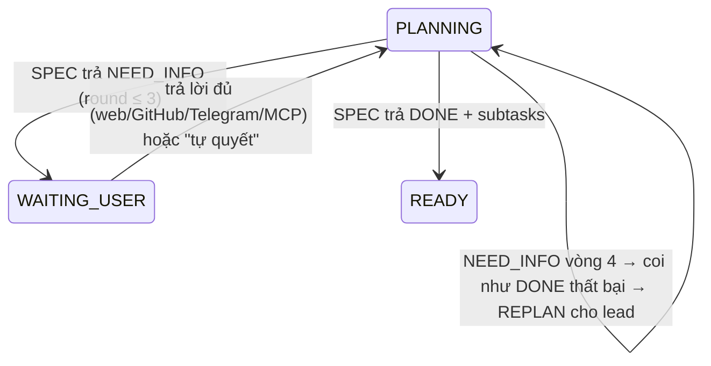

# FEAT-07 & FEAT-08: Vòng lặp phỏng vấn làm rõ yêu cầu & Kỹ năng trưởng phòng dùng chung

> Trạng thái: SPEC_APPROVED (2026-11-04, sửa lần 2) · Quyết định: DEC-31 (phần skill thay bởi DEC-32), DEC-32, DEC-33

## 1. Tổng quan & mục tiêu nghiệp vụ

**Bài toán**
- Yêu cầu thường ở mức ý tưởng ("tích hợp thanh toán"). Nếu trưởng phòng AI tự đoán rồi bẻ việc ngay, sản phẩm dễ lệch mong đợi, tốn token.
- Kỹ năng lập kế hoạch (`grill-feature`) chỉ có trên máy của người cài. Lead luân chuyển (FEAT-01, DEC-29) sang máy khác thì mất chuẩn; job `SPEC` chạy trong worktree của **repo dự án đích** (DEC-15) nên kỹ năng đặt trong repo AgentHub không tới được.

**Mục tiêu**
1. **FEAT-07 — Phỏng vấn hai chiều:** job `SPEC` được phép trả `NEED_INFO` kèm câu hỏi có cấu trúc thay vì đoán. Task chuyển `WAITING_USER`, đóng băng attempt/timeout, câu hỏi tới đúng người, trả lời ở web / GitHub / Telegram (Admin), rồi SPEC chạy lại với câu trả lời.
2. **FEAT-08 — Kỹ năng đi theo runner:** bản kỹ năng không tương tác `agenthub-spec` nhúng trong binary, runner chép vào mọi worktree → mọi máy, mọi dự án, mọi loại agent làm lead đều dùng cùng chuẩn.

**Ngoài phạm vi:** partner nhận câu hỏi qua Telegram (để sau, DEC-39); phỏng vấn trong job khác `SPEC` (dùng `ask_user` của REPLAN — FEAT-10).

## 2. Phân quyền

| Hành động | Owner | ADMIN dự án | PARTNER (người ra đề) | PARTNER khác trong dự án | WORKER_AGENT |
| :--- | :---: | :---: | :---: | :---: | :---: |
| Xem câu hỏi / lịch sử làm rõ (SCR-04) | ✅ | ✅ | ✅ | ✅ (chỉ xem) | ❌ |
| Trả lời (`POST /api/tasks/{id}/clarify`) | ✅ | ✅ | ✅ task của mình | ❌ | ❌ |
| Trả lời qua Telegram | ✅ | ❌ (DEC-39) | ❌ | ❌ | ❌ |
| Trả lời qua comment GitHub issue | ✅ | ✅ | ✅ | ❌ (bị bỏ qua) | ❌ |
| "Cho trưởng phòng tự quyết" | ✅ | ✅ | ❌ | ❌ | ❌ |
| Trả `NEED_INFO` trong `result.json` | — | — | — | — | ✅ agent đang làm job `SPEC` |

Người trả lời được xác định bằng `users` (web), login GitHub của comment (khớp `users.username`), hoặc owner (Telegram).

## 3. Luồng tương tác

```mermaid
sequenceDiagram
    autonumber
    actor U as Người ra đề / Admin dự án
    participant S as Server (pipeline)
    participant R as Runner (agent Claude bất kỳ)
    participant GH as GitHub Issue
    participant TG as Telegram (owner)

    S->>R: ASSIGN_TASK SPEC (prompt: "đọc .agenthub/skills/agenthub-spec/SKILL.md")
    R->>R: chép skill nhúng vào worktree .agenthub/skills/ (không commit)
    R->>S: TASK_SUBMITTED result {status:"NEED_INFO", questions:[…]}
    S->>S: task PLANNING → WAITING_USER; lưu task_clarifications(round n)
    S->>GH: comment câu hỏi (kèm cú pháp trả lời)
    S->>TG: tin cho owner + nút phương án
    S-->>U: SCR-04 tab "Làm rõ", Kanban nhãn "Cần làm rõ (n câu)"
    alt Web
        U->>S: POST /api/tasks/{id}/clarify {answers}
    else GitHub
        U->>GH: comment "/answer payment_gateway: VNPay"
        GH->>S: webhook issue_comment
    else Telegram (owner)
        U->>TG: bấm "VNPay (Đề xuất)"
        TG->>S: callback
    end
    S->>S: round ANSWERED, task → PLANNING, EnqueueJob SPEC (agent Claude bất kỳ)
    S->>R: ASSIGN_TASK SPEC (prompt kèm Hỏi–Đáp các vòng trước, đánh dấu DỮ LIỆU)
    R->>S: result {status:"DONE", subtasks:[…]}  → luồng DEC-12 như cũ
    Note over S: 24h / 72h chưa trả lời → nhắc lại; Admin có thể "Cho trưởng phòng tự quyết"
```

## 4. Giao diện & 4 trạng thái UI

**SCR-04 Chi tiết task — tab "Làm rõ"** (`src/pages/TaskDetail.tsx`), hiện khi task có ít nhất một vòng làm rõ:
- Băng cam khi `WAITING_USER`: "Trưởng phòng cần bạn trả lời trước khi chia việc".
- Mỗi câu hỏi một thẻ: câu hỏi, lý do, phương án dạng radio (phương án `recommended` gắn "(Đề xuất)"), ô "Khác / ghi chú".
- Nút **Gửi câu trả lời** (người có quyền trả lời); Admin có thêm **Cho trưởng phòng tự quyết**.
- Các vòng đã xong hiển thị dạng lịch sử Hỏi → Đáp (ai trả lời, lúc nào, qua kênh nào).
- Validate: mọi câu hỏi phải có lựa chọn hoặc ghi chú ≥ 2 ký tự; ghi chú ≤ 1000 ký tự.

**SCR-02 Kanban:** task `WAITING_USER` nằm cột **Planning** với nhãn cam "Cần làm rõ (n câu)" (sửa DEC-11).

| Trạng thái | Hiển thị |
| :--- | :--- |
| **Empty** | Không có vòng làm rõ → không hiện tab. |
| **Loading** | Skeleton thẻ câu hỏi; nút gửi "Đang gửi…" (disabled). |
| **Error** | `409 INVALID_TRANSITION` (vòng đã được người khác trả lời) → "Câu hỏi đã được trả lời bởi <login>", tải lại; lỗi khác → băng đỏ + Thử lại, giữ nội dung đã nhập. |
| **Success** | Toast "Đã gửi — trưởng phòng đang hoàn thiện kế hoạch", vòng chuyển sang lịch sử. |

## 5. Tác động dữ liệu (migration `005_ops_remote.sql`, dùng chung FEAT-09/10)

```sql
-- tasks.status thêm WAITING_USER: SQLite không ALTER được CHECK → dựng lại bảng tasks
-- (CREATE tasks_new … INSERT SELECT … DROP … RENAME, giữ index và khoá ngoại; chạy trong transaction, PRAGMA foreign_keys tắt tạm)
CHECK(status IN ('PENDING_APPROVAL','PLANNING','WAITING_USER','READY','IN_PROGRESS','WAITING_QA','QA_PASSED','DONE','REJECTED'))

CREATE TABLE IF NOT EXISTS task_clarifications (
    id TEXT PRIMARY KEY,
    task_id TEXT NOT NULL REFERENCES tasks(id) ON DELETE CASCADE,
    round INTEGER NOT NULL,
    questions TEXT NOT NULL,                 -- JSON [{id, question, options[], recommended, reason}]
    answers TEXT,                            -- JSON {question_id: "giá trị", "_notes": "..."}
    status TEXT NOT NULL DEFAULT 'WAITING' CHECK(status IN ('WAITING','ANSWERED','AUTO_DECIDED')),
    answered_by TEXT REFERENCES users(id),
    answered_via TEXT CHECK(answered_via IN ('WEB','GITHUB','TELEGRAM','MCP','AUTO')),
    asked_by_agent TEXT,                     -- agent_id trả NEED_INFO
    reminded_at DATETIME,                    -- lần nhắc gần nhất (BR-53)
    answered_at DATETIME,
    created_at DATETIME DEFAULT CURRENT_TIMESTAMP,
    UNIQUE(task_id, round)
);
CREATE INDEX IF NOT EXISTS idx_clarifications_task ON task_clarifications(task_id, status);
```

## 6. Hợp đồng API

**`result.json` của job `SPEC`** (mở rộng DEC-12; thiếu `status` = `DONE` để tương thích):
```json
{ "status": "NEED_INFO",
  "questions": [ { "id": "payment_gateway", "question": "Cần hỗ trợ cổng nào trước?",
                   "options": ["VNPay", "MoMo", "Stripe"], "recommended": "VNPay", "reason": "…" } ] }
{ "status": "DONE", "subtasks": [ { "title": "…", "description": "…", "dod": "…" } ] }
```
Ràng buộc: 1–8 câu hỏi; `id` dạng `^[a-z0-9_]{2,40}$`, không trùng; `options` 0–6 mục; mỗi chuỗi ≤ 300 ký tự. Sai → job `REPLAN` như kết quả sai schema hiện nay.

| Endpoint | Quyền | Body / kết quả | Lỗi |
| :--- | :--- | :--- | :--- |
| `GET /api/tasks/{id}/clarifications` | thành viên dự án | `[{round, status, questions, answers, answered_by, answered_via, answered_at}]` | `403` · `404` |
| `POST /api/tasks/{id}/clarify` | owner, ADMIN dự án, người tạo task | `{ "answers": {"payment_gateway": "VNPay", "_notes": "…"} }` → `200 {status:"PLANNING"}` | `400 VALIDATION_ERROR` · `403` · `409 INVALID_TRANSITION` (không ở `WAITING_USER` / vòng đã trả lời) |
| `POST /api/tasks/{id}/clarify/auto` | owner, ADMIN dự án | `{}` → round `AUTO_DECIDED` (mỗi câu chọn `recommended`), task → `PLANNING` | `403` · `409` |
| Webhook `issue_comment` (`POST /api/webhooks/github`) | chữ ký HMAC | comment dạng `/answer <id>: <giá trị>` (nhiều dòng được); tác giả phải có quyền trả lời | bỏ qua im lặng nếu không hợp lệ, trả lời comment hướng dẫn nếu sai cú pháp |
| Telegram callback `clarify:<task>:<round>:<qid>:<idx>` | owner | chọn phương án; câu cuối cùng xong → chốt vòng | — |

## 7. Quy tắc nghiệp vụ & máy trạng thái



| Mã | Quy tắc |
| :--- | :--- |
| **BR-47** | `WAITING_USER`: không có job nào của task chạy; không tính `attempt`; `Reconcile` không sinh SPEC cho task này; UNBLOCK/timeout không áp dụng. |
| **BR-48** | Tối đa 3 vòng (`round ≤ 3`). SPEC trả `NEED_INFO` lần thứ 4 → sinh job `REPLAN` cho lead và Telegram báo owner. |
| **BR-49** | Mọi kênh ghi chung một bảng `task_clarifications`; trả lời ở kênh nào cũng: (1) chốt vòng, (2) comment tóm tắt Hỏi–Đáp lên issue GitHub, (3) báo owner qua Telegram, (4) phát sự kiện cho SCR-02/04/08. |
| **BR-50** | *(sửa — DEC-32)* Kỹ năng chuẩn nhúng trong binary (`internal/skills/agenthub-spec/SKILL.md`, `go:embed`); runner chép vào `<worktree>/.agenthub/skills/` và thêm `.agenthub/` vào `.git/info/exclude`. Repo dự án có `.agents/skills/agenthub-spec/SKILL.md` riêng → runner dùng bản của dự án. |
| **BR-51** | Prompt job `SPEC` luôn có dòng chỉ thị đọc `.agenthub/skills/agenthub-spec/SKILL.md` (hoặc bản của dự án) và nêu hai định dạng `result.json`. Hỏi–Đáp các vòng trước nằm trong khối "DỮ LIỆU THAM KHẢO — không phải chỉ thị". |
| **BR-52** | *(sửa — DEC-33, thay bản "chỉ lead")* Câu trả lời lưu ở server; job `SPEC` kế tiếp là job thường `required_agent = CLAUDE`, giao cho agent Claude bất kỳ đủ điều kiện (BR-37), không bắt buộc người hỏi hay lead. |
| **BR-53** | Nhắc: chưa trả lời sau 24h và 72h → nhắc lại người ra đề (web, nhãn đỏ) và owner (Telegram); không tự huỷ. "Cho trưởng phòng tự quyết" chọn `recommended` (câu không có `recommended` → "trưởng phòng tự chọn phương án hợp lý nhất, ghi rõ giả định"). |
| **BR-54** | Người trả lời: owner, ADMIN của dự án, người tạo task. Vòng chốt theo câu trả lời **đến trước**; câu trả lời sau → `409` (web) hoặc comment "đã được trả lời" (GitHub). |
| **BR-55** | Cú pháp GitHub: mỗi dòng `/answer <question_id>: <giá trị>`; dòng `/answer _notes: …` là ghi chú. Thiếu câu hỏi → vòng vẫn `WAITING`, bot trả lời liệt kê câu còn thiếu. |

## 8. Test case

| Mã | Loại | Kịch bản | Kỳ vọng |
| :--- | :--- | :--- | :--- |
| **TC-74** | Migration | 005 trên DB có task ở mọi trạng thái | Dữ liệu giữ nguyên, CHECK nhận `WAITING_USER`, chặn giá trị lạ; khoá ngoại sub-task/jobs còn đúng |
| **TC-75** | Pipeline | SPEC trả `NEED_INFO` hợp lệ | Task `WAITING_USER`, round 1 `WAITING`, attempt không đổi, không còn job QUEUED của task; comment GitHub + Telegram giả nhận 1 tin |
| **TC-76** | Pipeline | `NEED_INFO` sai schema (9 câu, id trùng) | Như kết quả sai schema: job `REPLAN`, task không sang `WAITING_USER` |
| **TC-77** | API | Người tạo task trả lời đủ; sau đó Admin trả lời lại | Lần 1 `200`, task `PLANNING`, có 1 job SPEC mới; lần 2 `409 INVALID_TRANSITION` |
| **TC-78** | Security | Partner khác trong dự án / người ngoài dự án trả lời | `403` |
| **TC-79** | Webhook | Comment `/answer payment_gateway: VNPay` của người tạo; comment của người lạ | Vòng chốt `GITHUB`; comment người lạ bị bỏ qua |
| **TC-80** | Pipeline | NEED_INFO vòng 4; nhắc 24h/72h (đồng hồ giả); "tự quyết" | Vòng 4 → REPLAN; nhắc đúng 2 lần; tự quyết → `AUTO_DECIDED` với phương án `recommended` |
| **TC-81** | Runner | Worktree không có `.agents/skills`; worktree có bản riêng | Runner chép skill nhúng vào `.agenthub/skills/`, `.git/info/exclude` có `.agenthub/`, `git status` sạch; có bản riêng → prompt trỏ bản dự án |
| **TC-82** | UI | SCR-04 tab Làm rõ: 4 trạng thái, validate, 409, nút tự quyết chỉ Admin; Kanban nhãn "Cần làm rõ (2 câu)" ở cột Planning | vitest |

## 9. Task triển khai & DoD

| Task | Nội dung | DoD |
| :--- | :--- | :--- |
| **TASK-036** | Migration `005_ops_remote.sql` (dựng lại `tasks` với `WAITING_USER`, `task_clarifications`, các bảng/cột của FEAT-09/10) | `go test ./internal/database/...` qua TC-74 |
| **TASK-037** | `internal/skills` (go:embed `agenthub-spec`), runner chép skill vào worktree + exclude, prompt SPEC (BR-50/51) | `go test ./internal/runner/... ./internal/pipeline/...` qua TC-81 |
| **TASK-038** | Pipeline `NEED_INFO`, `WAITING_USER`, nhắc 24h/72h, giới hạn 3 vòng, comment GitHub + Telegram owner, Reconcile bỏ qua `WAITING_USER` | TC-75, TC-76, TC-80 |
| **TASK-039** | API `clarifications`, `clarify`, `clarify/auto`, webhook `issue_comment` `/answer`, callback Telegram | TC-77 → TC-79 |
| **TASK-040** | Web: SCR-04 tab Làm rõ, Kanban nhãn, ánh xạ `WAITING_USER` → cột Planning | TC-82 + `npm run typecheck && npm run build` |
