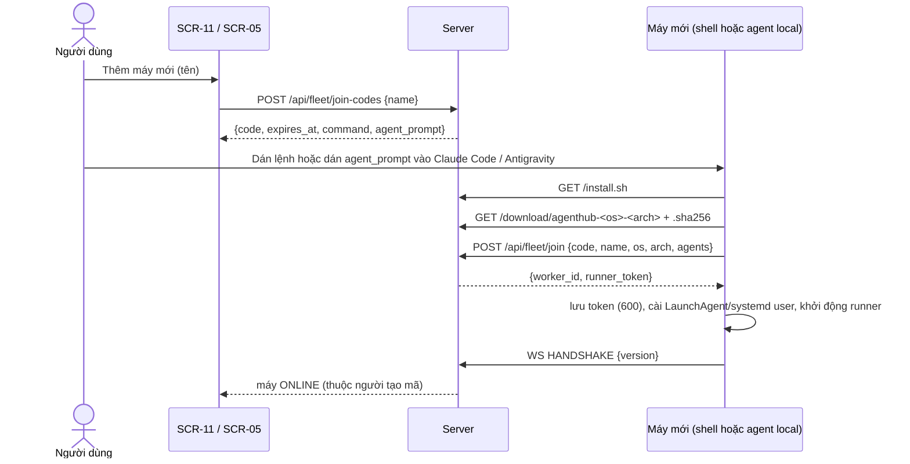

# FEAT-05: Thêm máy bằng một lệnh, máy của partner, trang Đóng góp

> Trạng thái: DONE (2026-11-04) · Quyết định: DEC-18, DEC-19, DEC-20, DEC-21

## 1. Tổng quan & mục tiêu nghiệp vụ
Bất kỳ người dùng đã đăng nhập (owner hoặc partner) thêm được máy của mình vào AgentHub chỉ bằng một lệnh, hoặc dán một khối hướng dẫn cho agent AI đang chạy trên máy đó để nó tự làm. Quản trị thấy rõ máy thuộc ai, đang chạy dự án gì; trang Đóng góp tổng hợp công việc theo partner và theo dự án.

## 2. Phân quyền
| Hành động | Owner | Partner |
| :--- | :---: | :---: |
| Tạo mã tham gia cho máy của mình | ✅ | ✅ |
| Xem / tạm dừng / gỡ máy của mình, chọn dự án cho máy mình | ✅ | ✅ (chỉ dự án mình là thành viên) |
| Xem mọi máy (SCR-05), nhóm theo chủ | ✅ | ❌ |
| Bật/tắt `lead_eligible` | ✅ | ❌ |
| Trang Đóng góp | tất cả | chỉ phần của mình + dự án mình là thành viên |

## 3. Luồng tương tác


## 4. Giao diện & 4 trạng thái UI
- **SCR-11 Máy của tôi** (`/my/machines`, `src/pages/MyMachines.tsx`, mọi người dùng): danh sách máy của mình (trạng thái, phiên bản, agent, dự án + task đang chạy), nút Tạm dừng / Gỡ, ô chọn dự án; nút **Thêm máy mới**.
- **Hộp thoại Thêm máy** (dùng chung SCR-05 và SCR-11): nhập tên (`^[a-zA-Z0-9-]{2,40}$`) → hiện (1) lệnh một dòng, (2) khối "Hướng dẫn cho agent" — mỗi thứ có nút Sao chép; đồng hồ đếm ngược 15 phút; hết hạn → nút Tạo mã mới. Trạng thái: tạo mã (loading), lỗi (banner), đang chờ máy kết nối, đã kết nối ✓ (tự cập nhật qua `GET /api/my/machines` mỗi 3 giây khi hộp thoại mở).
- **SCR-05 Cụm máy** (owner): nhóm theo chủ máy; mỗi agent hiện dự án + task đang chạy; công tắc "Cho làm trưởng phòng"; cột phiên bản.
- **SCR-10 Đóng góp** (`/contributions`, `src/pages/Contributions.tsx`, mọi người dùng): bộ lọc khoảng thời gian (7/30/90 ngày, tuỳ chọn), xem theo Partner / Dự án; bảng tổng hợp; bấm dòng → dòng thời gian. Rỗng: "Chưa có đóng góp trong khoảng này".

**Khối hướng dẫn cho agent** (server sinh, Markdown):
```
# Nhiệm vụ: nối máy này vào AgentHub (<BASE_URL>) với tên "<name>"
Mã tham gia (dùng một lần, hết hạn <giờ>): <code>
1. Kiểm công cụ: git, gh, go, node; agent CLI: claude và/hoặc agy. Thiếu → hỏi người dùng rồi cài theo hệ điều hành (macOS: Homebrew).
2. Chạy: curl -fsSL <BASE_URL>/install.sh | sh -s -- --join <code> --name <name>
3. Đăng nhập (nhờ NGƯỜI DÙNG làm, không tự làm): `gh auth login`, `claude` → /login, `agy` (nếu dùng).
4. Kiểm: `~/.agenthub/agenthub runner --status` báo ONLINE; báo lại danh sách agent đã nhận.
Ràng buộc: không in/gửi token; không dùng chế độ bỏ qua quyền (`--dangerously-skip-permissions`); không sửa cấu hình ngoài ~/.agenthub và dịch vụ runner.
```

## 5. Tác động dữ liệu (migration `003_join_machine.sql`)
```sql
ALTER TABLE workers ADD COLUMN owner_user_id TEXT REFERENCES users(id) ON DELETE SET NULL;
ALTER TABLE workers ADD COLUMN version TEXT;
ALTER TABLE workers ADD COLUMN paused INTEGER NOT NULL DEFAULT 0;
ALTER TABLE agents ADD COLUMN lead_eligible INTEGER NOT NULL DEFAULT 1;
CREATE TABLE join_codes (
    code_hash TEXT PRIMARY KEY,            -- SHA-256 của mã
    owner_user_id TEXT NOT NULL REFERENCES users(id) ON DELETE CASCADE,
    worker_name TEXT NOT NULL,
    expires_at DATETIME NOT NULL,
    used_at DATETIME,
    created_at DATETIME DEFAULT CURRENT_TIMESTAMP
);
```
- Máy đăng ký qua `/api/fleet/join` của partner: `agents.lead_eligible = 0`; của owner: 1 cho Claude, **0 cho Antigravity** (DEC-29, migration 004 sửa dữ liệu cũ). Máy cũ (đăng ký bằng `RUNNER_REGISTRATION_KEY`) `owner_user_id = NULL` → hiển thị "Hệ thống".
- Trang Đóng góp không thêm bảng (DEC-21).

## 6. Hợp đồng API
| Endpoint | Quyền | Body | Kết quả |
| :--- | :--- | :--- | :--- |
| `POST /api/fleet/join-codes` | đăng nhập | `{name}` | `{code, expires_at, command, agent_prompt}`; tên trùng máy của người khác → 409 |
| `POST /api/fleet/join` | mã tham gia | `{code, name, os, arch, agents:[kind]}` | `{worker_id, runner_token}`; mã sai/hết hạn/đã dùng → 401 `UNAUTHORIZED`; > 5 lần/phút/IP → 429 |
| `GET /install.sh` | công khai | – | `text/x-shellscript`, chèn sẵn `BASE_URL` |
| `GET /download/agenthub-{os}-{arch}` (+ `.sha256`) | công khai | – | binary từ `RUNNERS_DIR`; không có → 404 |
| `GET /api/my/machines` | đăng nhập | – | máy của mình (như `GET /api/fleet` rút gọn) |
| `PATCH /api/my/machines/{id}` | chủ máy | `{paused?, projects?}` | 200; không phải chủ → 403 |
| `DELETE /api/my/machines/{id}` | chủ máy hoặc owner | – | 204; thu hồi assignment, vô hiệu token |
| `PATCH /api/admin/agents/{id}` | owner | thêm `lead_eligible` | 200 |
| `GET /api/contributions?by=partner|project&from&to` | đăng nhập | – | `[{key, label, machines, jobs:{done,failed,exhausted,by_kind}, tasks_done, prs_merged, busy_hours}]` |
| `GET /api/contributions/timeline?partner|project=&from&to` | đăng nhập | – | `[{at, worker, agent, job_kind, task_id, task_title, project, result, attempt}]` |
| WS `HANDSHAKE.data.version`, `HANDSHAKE_OK.server_version` | – | – | DEC-19 |

## 7. Quy tắc nghiệp vụ
| Mã | Quy tắc |
| :--- | :--- |
| **BR-30** | Mã tham gia: 8 ký tự dạng `XXXX-XXXX` (bảng chữ không gây nhầm), `crypto/rand`, lưu SHA-256, hết hạn 15 phút, dùng đúng một lần (`UPDATE … WHERE used_at IS NULL`). |
| **BR-31** | `install.sh` chỉ cài vào `~/.agenthub` và dịch vụ runner của user hiện tại; binary phải khớp `.sha256` mới chạy; không cài phần mềm khác; in bảng kiểm công cụ + lệnh gợi ý. |
| **BR-32** | Máy `paused`: runner vẫn kết nối nhưng dispatcher không giao việc; gỡ máy → assignment ACTIVE `RECLAIMED` ngay, `token_hash` đổi thành giá trị không dùng được, gateway đóng kết nối. |
| **BR-33** | Chọn lead (BR-06) chỉ xét agent `lead_eligible = 1`. |
| **BR-34** | Partner chỉ gán máy mình cho dự án mình là thành viên; mất tư cách thành viên → bỏ dự án đó khỏi `agent_projects` của máy họ. |
| **BR-35** | Tự cập nhật: khác `server_version` → chờ mọi agent rảnh → tải + kiểm SHA-256 → thay binary → thoát mã 0 để dịch vụ khởi động lại; tải/kiểm lỗi → giữ bản cũ, thử lại sau 30 phút. |
| **BR-36** | Đóng góp quy cho **chủ máy** của agent làm job; giờ máy = tổng `ended_at − started_at` của assignment trong khoảng lọc. |

## 8. Test case
| Mã | Kịch bản | Kỳ vọng |
| :--- | :--- | :--- |
| TC-46 | Dùng mã hai lần / sau 15 phút / mã sai | 401 |
| TC-47 | 6 lần sai trong 1 phút cùng IP | lần 6 → 429 |
| TC-48 | Join thành công | máy thuộc người tạo mã; partner → `lead_eligible = 0` |
| TC-49 | Partner PATCH máy người khác | 403 |
| TC-50 | Partner gán máy cho dự án không là thành viên | 400/403 |
| TC-51 | Máy paused | không nhận job |
| TC-52 | Gỡ máy đang làm | assignment RECLAIMED, token cũ bị từ chối |
| TC-53 | Agent `lead_eligible = 0` | không bao giờ nhận lease |
| TC-54 | `install.sh` trong môi trường giả (server giả, `uname` giả) | tải đúng binary, sai SHA-256 → dừng |
| TC-55 | Runner khác phiên bản | cập nhật khi rảnh, không khi bận |
| TC-56 | Đóng góp theo partner / dự án | số liệu khớp dữ liệu mẫu; partner chỉ thấy phần mình |

## 9. Task triển khai & DoD
| Task | Nội dung | DoD |
| :--- | :--- | :--- |
| **TASK-023** | Migration 003, mã tham gia, `/api/fleet/join`, `/install.sh`, `/download`, máy của tôi (API), paused/gỡ, `lead_eligible`, runner `--status` + tự cập nhật | TC-46 → TC-55 |
| **TASK-024** | UI: hộp thoại Thêm máy (lệnh + hướng dẫn agent), SCR-11 Máy của tôi, SCR-05 nhóm theo chủ + công tắc trưởng phòng | vitest + typecheck + build |
| **TASK-025** | Đóng góp: API + SCR-10 | TC-56 + vitest |
| **TASK-029** | Gateway: `HANDSHAKE_OK.server_version`, lưu `HANDSHAKE.data.version` vào `workers.version`, `Hub.CloseWorker` cho gỡ máy (BR-32) | test Go `internal/gateway` |
