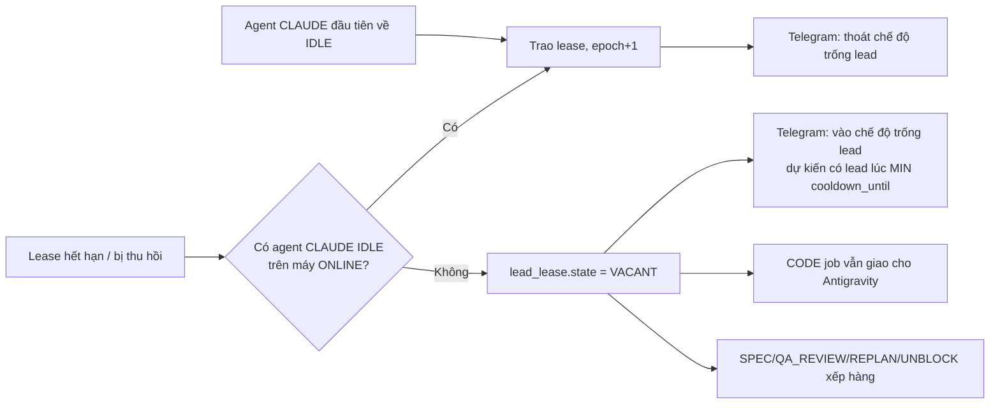
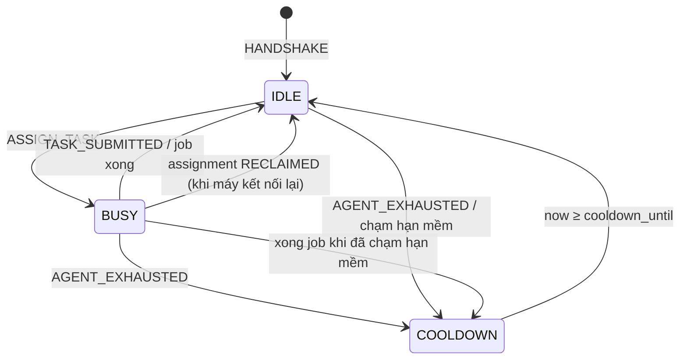
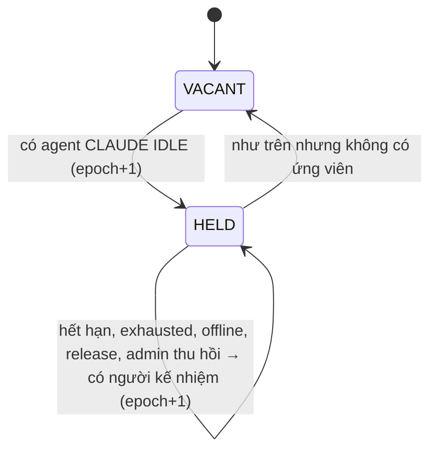

# FEAT-01: Luân chuyển Trưởng phòng & Chuyển giao khi hết limit

> Quyết định liên quan: DEC-01 → DEC-06, DEC-09, **DEC-29** (`docs/14-decisions.md`).
>
> **Sửa đổi 2026-11-04 (DEC-29, FEAT-06):** lead không còn khoá cho Claude — agent bất kỳ có `lead_eligible = 1` đều là ứng viên; agent `NEEDS_AUTH` bị loại (BR-37, BR-40, BR-42 ở [agent-auth.md](agent-auth.md)). Các chỗ ghi "Claude" trong sơ đồ dưới là ví dụ mặc định.

## 1. Tổng quan & mục tiêu nghiệp vụ

**Bài toán:** Mọi agent AI (Claude, Antigravity) đều có thể chạm rate limit hoặc mất kết nối bất cứ lúc nào. Nếu trưởng phòng (Claude) dừng, cả dây chuyền dừng; nếu một máy dừng giữa task, công sức bị mất.

**Mục tiêu:**
1. Máy rảnh tự hỗ trợ máy khác: job của máy đang nghỉ được máy `IDLE` khác nhận làm tiếp, không làm lại từ đầu.
2. Luôn có tối đa **một** trưởng phòng trực (lead) tại một thời điểm; lead hết limit hoặc mất kết nối → vai được trao cho agent Claude kế tiếp trong ≤ 90 giây, không cần người can thiệp.
3. Không còn Claude nào → phần code vẫn chạy tiếp, việc trí tuệ xếp hàng chờ.
4. Không bao giờ có hai bên cùng nộp kết quả cho một job, hay hai lead cùng ra lệnh (fencing bằng `assignment_id` và `epoch`).

**Khái niệm:**
| Thuật ngữ | Nghĩa |
| :--- | :--- |
| **Máy (worker)** | Một máy vật lý chạy Runner Daemon, giữ một kết nối WebSocket. |
| **Agent** | Một CLI trên máy (`CLAUDE` hoặc `ANTIGRAVITY`). Một máy có thể có nhiều agent. |
| **Job** | Một đơn vị việc trong hàng đợi, gắn với một task: `SPEC`, `CODE`, `QA_REVIEW`, `REPLAN`, `UNBLOCK` (dành sẵn `DESIGN`, `TEST_WRITE` cho dây chuyền vai trò sau này). |
| **Assignment** | Một lần giao một job cho một agent. `assignment_id` là mã fencing. |
| **Lead trực** | Agent Claude đang giữ `lead_lease`. Là người duy nhất nhận job `REPLAN`/`UNBLOCK` và gửi `LEAD_ACTION`. |
| **Epoch** | Số thế hệ của lease, tăng mỗi lần đổi lead. |
| **COOLDOWN** | Agent đang nghỉ vì hết limit (cứng) hoặc chạm hạn mềm, đến `cooldown_until`. |

**Phân hệ:** 3 (Orchestrator — thêm Lead Lease Manager, Job Queue) và 4 (Gateway & Runner Fleet — thêm phát hiện hết limit, trạng thái agent).

## 2. Phân quyền

| Hành động | ADMIN | PARTNER | WORKER_AGENT |
| :--- | :---: | :---: | :---: |
| Xem danh sách agent, lead hiện tại, cooldown (`GET /api/fleet`) | ✅ | ❌ | ❌ |
| Trao vai lead cho một agent (`POST /api/admin/lead/assign`) | ✅ | ❌ | ❌ |
| Thu hồi vai lead (`POST /api/admin/lead/revoke`) | ✅ | ❌ | ❌ |
| Sửa `lead_priority`, hạn mềm của agent (`PATCH /api/admin/agents/:id`) | ✅ | ❌ | ❌ |
| Gửi `AGENT_EXHAUSTED` | ❌ | ❌ | ✅ chỉ cho agent thuộc máy của mình |
| Gửi `LEASE_RENEW`, `LEAD_RELEASE`, `LEAD_ACTION` | ❌ | ❌ | ✅ chỉ agent đang giữ lease, đúng `epoch` |

Partner không thấy bất kỳ thông tin agent/lead/cooldown nào (kể cả qua Kanban).

## 3. Luồng tương tác

### 3.1 Agent đang làm job CODE thì hết limit

```mermaid
sequenceDiagram
    autonumber
    participant AGY as Antigravity (Máy A)
    participant RA as Runner A
    participant S as Server
    participant GH as GitHub
    participant RB as Runner B (agent IDLE)

    AGY-->>RA: exit≠0, stderr khớp exhaust_patterns
    RA->>RA: git commit -m "wip(task-102): attempt 1 handoff [by Runner]"
    RA->>GH: git push feat/task-102
    RA->>RA: handoff_note = git diff --stat + 50 dòng log cuối
    RA->>S: AGENT_EXHAUSTED {agent_id, assignment_id, resets_at, reason, handoff_note, wip_commit}
    S->>S: Kiểm assignment_id hiện hành → assignment = EXHAUSTED
    S->>S: agent A = COOLDOWN tới resets_at; job QUEUED, attempt=2
    RB->>S: REQUEST_TASK {agent_id}
    S-->>RB: ASSIGN_TASK {assignment_id mới, attempt=2, branch, handoff_note}
    RB->>RB: git fetch && git worktree add .worktrees/task-102 feat/task-102
```

### 3.2 Lead hết limit → chuyển giao

```mermaid
sequenceDiagram
    autonumber
    participant L1 as Lead cũ (Claude, Máy A)
    participant S as Server
    participant L2 as Claude IDLE (Máy B)
    participant T as Telegram

    L1->>S: AGENT_EXHAUSTED {agent_id, resets_at}
    S->>S: agent A = COOLDOWN; lead_lease: epoch 7 → 8, holder = chọn theo BR-06
    S->>S: lead_journal += "HANDOVER 7→8, lý do EXHAUSTED"
    S-->>L1: LEASE_REVOKED {epoch: 7, reason: EXHAUSTED}
    S-->>L2: LEASE_GRANTED {epoch: 8, expires_at}
    S->>T: "👑 Lead đổi: mac-mini/claude → laptop/claude (hết limit, reset 21:40)"
    loop mỗi 30 giây
        L2->>S: LEASE_RENEW {epoch: 8}
    end
    Note over L1,S: Lead cũ gửi LEAD_ACTION {epoch: 7} → ERROR STALE_EPOCH
```

### 3.3 Không còn Claude khả dụng (trống lead)



## 4. Giao diện & 4 trạng thái UI

**Không thêm màn hình.** Sửa **SCR-05 Fleet** (`/fleet`, `src/pages/Fleet.tsx`):

```
┌─ Lead hiện tại: mac-mini/claude · epoch 7 · gia hạn sau 82s ── [Thu hồi vai] ─┐
└───────────────────────────────────────────────────────────────────────────────┘
Máy        Kết nối   Agent    Trạng thái          Ưu tiên lead   Hạn mềm     Thao tác
mac-mini   🟢        claude   ★ LEAD · BUSY #101  1              7/20 · 5h   [Sửa]
mac-mini   🟢        agy      IDLE                –              –           [Sửa]
laptop     🟢        claude   ☕ COOLDOWN 41:12   2              20/20 · 5h  [Trao vai] [Sửa]
server     ⚫ 1m20s  agy      BUSY #102 (lần 2)   –              –           [Log]
```

- **Thẻ Lead** trên cùng: tên agent, `epoch`, thời gian đến lần gia hạn kế tiếp. Trạng thái `VACANT` → thẻ màu hổ phách "Chưa có trưởng phòng — dự kiến 21:40", job trí tuệ đang chờ: N.
- **Nút "Trao vai"** chỉ hiện ở agent `lead_eligible` (mọi loại, DEC-29), `IDLE`, không `NEEDS_AUTH`, máy `ONLINE`, không phải lead hiện tại. Bấm → hộp xác nhận "Trao vai lead cho laptop/claude? Lead hiện tại sẽ bị thu hồi."
- **Nút "Thu hồi vai"** → hộp xác nhận; sau khi thu hồi server tự chọn người kế nhiệm theo BR-06, loại trừ agent vừa bị thu hồi trong 10 phút.
- **Drawer "Sửa agent"**: `lead_priority` (số nguyên 1–99 hoặc để trống), `soft_max_jobs` (1–500 hoặc trống = tắt), `soft_window_hours` (1–24).
- **LED:** 🟢 `ONLINE`, ⚫ `OFFLINE` (kèm thời gian mất kết nối); agent: xanh `IDLE`, vàng cam `BUSY`, tím `COOLDOWN` (kèm đếm ngược).

| Trạng thái | Hiển thị |
| :--- | :--- |
| **Empty** | "Chưa có máy nào kết nối" + nút "Thêm máy mới" (hướng dẫn `POST /api/fleet/register`). |
| **Loading** | Skeleton cho thẻ Lead và 3 dòng bảng. |
| **Error** | Banner đỏ "Mất kết nối máy chủ — đang thử lại" + nút "Thử lại"; giữ dữ liệu cũ, làm mờ. Lỗi thao tác (`409 AGENT_NOT_ELIGIBLE`) → toast "Agent không còn đủ điều kiện nhận vai (đang bận/nghỉ/mất kết nối)". |
| **Success** | Bảng như trên, cập nhật trực tiếp qua WebSocket dashboard. |

**Validate:** `lead_priority` ∈ [1, 99] hoặc null; `soft_max_jobs` ∈ [1, 500] hoặc null; `soft_window_hours` ∈ [1, 24]; mọi agent có `lead_priority` (DEC-29).

## 5. Tác động dữ liệu (diff schema)

```diff
 CREATE TABLE workers (
     id TEXT PRIMARY KEY,
     name TEXT NOT NULL,
-    agent_type TEXT NOT NULL CHECK(agent_type IN ('CLAUDE', 'ANTIGRAVITY')),
     os TEXT NOT NULL,
-    status TEXT NOT NULL DEFAULT 'OFFLINE' CHECK(status IN ('ONLINE', 'BUSY', 'OFFLINE')),
-    capabilities TEXT NOT NULL DEFAULT '[]',
+    conn_status TEXT NOT NULL DEFAULT 'OFFLINE' CHECK(conn_status IN ('ONLINE', 'OFFLINE')),
+    offline_since DATETIME,
     token_hash TEXT NOT NULL,
     last_heartbeat DATETIME,
     created_at DATETIME DEFAULT CURRENT_TIMESTAMP
 );
```

```sql
-- Agent = một CLI trên một máy
CREATE TABLE IF NOT EXISTS agents (
    id TEXT PRIMARY KEY,                       -- "<worker_id>/<kind>" vd "mac-mini/claude"
    worker_id TEXT NOT NULL REFERENCES workers(id) ON DELETE CASCADE,
    kind TEXT NOT NULL CHECK(kind IN ('CLAUDE', 'ANTIGRAVITY')),
    status TEXT NOT NULL DEFAULT 'IDLE' CHECK(status IN ('IDLE', 'BUSY', 'COOLDOWN')),
    cooldown_until DATETIME,
    cooldown_reason TEXT CHECK(cooldown_reason IN ('EXHAUSTED', 'SOFT_LIMIT')),
    lead_priority INTEGER CHECK(lead_priority BETWEEN 1 AND 99),   -- chỉ dùng cho CLAUDE
    soft_max_jobs INTEGER CHECK(soft_max_jobs BETWEEN 1 AND 500),  -- NULL = tắt hạn mềm
    soft_window_hours INTEGER NOT NULL DEFAULT 5 CHECK(soft_window_hours BETWEEN 1 AND 24),
    idle_since DATETIME,
    created_at DATETIME DEFAULT CURRENT_TIMESTAMP,
    UNIQUE(worker_id, kind)
);
CREATE INDEX IF NOT EXISTS idx_agents_status ON agents(kind, status);

-- Hàng đợi việc (cả việc trí tuệ lẫn việc code)
CREATE TABLE IF NOT EXISTS jobs (
    id TEXT PRIMARY KEY,
    project_id TEXT NOT NULL REFERENCES projects(id) ON DELETE CASCADE,  -- sẵn cho đa dự án
    task_id TEXT NOT NULL REFERENCES tasks(id) ON DELETE CASCADE,
    kind TEXT NOT NULL CHECK(kind IN ('SPEC','DESIGN','TEST_WRITE','CODE','QA_REVIEW','REPLAN','UNBLOCK')),
    required_agent TEXT NOT NULL CHECK(required_agent IN ('CLAUDE', 'ANTIGRAVITY')),
    lead_only INTEGER NOT NULL DEFAULT 0,      -- 1: chỉ giao cho lead đang giữ lease
    status TEXT NOT NULL DEFAULT 'QUEUED' CHECK(status IN ('QUEUED','RUNNING','DONE','FAILED','CANCELLED')),
    priority INTEGER NOT NULL DEFAULT 100,     -- nhỏ hơn = ưu tiên hơn
    attempt INTEGER NOT NULL DEFAULT 0,
    branch_name TEXT,                          -- NULL với job không có code
    current_assignment_id TEXT,
    created_at DATETIME DEFAULT CURRENT_TIMESTAMP,
    updated_at DATETIME DEFAULT CURRENT_TIMESTAMP
);
CREATE INDEX IF NOT EXISTS idx_jobs_queue ON jobs(status, required_agent, priority, created_at);

-- Mỗi lần giao một job cho một agent (mã fencing)
CREATE TABLE IF NOT EXISTS assignments (
    id TEXT PRIMARY KEY,                       -- assignment_id
    job_id TEXT NOT NULL REFERENCES jobs(id) ON DELETE CASCADE,
    agent_id TEXT NOT NULL REFERENCES agents(id),
    attempt INTEGER NOT NULL,
    status TEXT NOT NULL DEFAULT 'ACTIVE'
        CHECK(status IN ('ACTIVE','SUBMITTED','EXHAUSTED','RECLAIMED','ABORTED','FAILED')),
    handoff_note TEXT,                         -- runner tự sinh, coi là dữ liệu không tin cậy
    wip_commit TEXT,
    last_log_at DATETIME,
    started_at DATETIME DEFAULT CURRENT_TIMESTAMP,
    ended_at DATETIME
);
CREATE INDEX IF NOT EXISTS idx_assignments_agent ON assignments(agent_id, started_at);

-- Lease trưởng phòng: đúng 1 dòng
CREATE TABLE IF NOT EXISTS lead_lease (
    id INTEGER PRIMARY KEY CHECK(id = 1),
    state TEXT NOT NULL DEFAULT 'VACANT' CHECK(state IN ('HELD', 'VACANT')),
    agent_id TEXT REFERENCES agents(id) ON DELETE SET NULL,
    epoch INTEGER NOT NULL DEFAULT 0,
    expires_at DATETIME,
    vacant_since DATETIME
);
INSERT OR IGNORE INTO lead_lease (id, state, epoch) VALUES (1, 'VACANT', 0);

-- Nhật ký bàn giao của lead (người kế nhiệm đọc để làm tiếp)
CREATE TABLE IF NOT EXISTS lead_journal (
    id INTEGER PRIMARY KEY AUTOINCREMENT,
    epoch INTEGER NOT NULL,
    agent_id TEXT,                             -- NULL khi do server ghi
    task_id TEXT REFERENCES tasks(id) ON DELETE CASCADE,
    kind TEXT NOT NULL CHECK(kind IN ('HANDOVER','DECISION','NOTE','ACTION')),
    entry TEXT NOT NULL,
    created_at DATETIME DEFAULT CURRENT_TIMESTAMP
);
CREATE INDEX IF NOT EXISTS idx_lead_journal_task ON lead_journal(task_id, created_at);
```

**`tasks`:** giữ nguyên các cột; `assigned_worker_id` không còn là nguồn sự thật (suy ra từ `jobs.current_assignment_id → assignments.agent_id`), giữ để hiển thị, sẽ bỏ ở bản sau.

**`task_logs`:** đổi `worker_id` → thêm `assignment_id TEXT REFERENCES assignments(id)` để biết log thuộc lần thử nào.

**Migration:** dự án chưa có dữ liệu thật → sửa thẳng `schema.sql`, không cần migration chuyển đổi.

## 6. Hợp đồng API

### 6.1 WebSocket `/ws/agent` — Runner → Server

```json
{ "event": "HANDSHAKE", "token": "…",
  "data": { "os": "darwin", "agents": [ { "kind": "CLAUDE" }, { "kind": "ANTIGRAVITY" } ] } }

{ "event": "REQUEST_TASK", "agent_id": "mac-mini/antigravity" }

{ "event": "LOG_CHUNK", "assignment_id": "asg_…", "chunk": "…" }

{ "event": "TASK_SUBMITTED", "assignment_id": "asg_…", "pr_url": "…", "branch": "feat/task-102" }

{ "event": "AGENT_EXHAUSTED", "agent_id": "mac-mini/claude",
  "assignment_id": "asg_…",            // null nếu agent đang rảnh
  "resets_at": "2026-11-03T21:40:00Z", // null nếu không đọc được → server dùng default_cooldown_min
  "reason": "usage limit reached",
  "handoff_note": "…", "wip_commit": "a1b2c3d" }

{ "event": "LEASE_RENEW", "agent_id": "mac-mini/claude", "epoch": 8 }

{ "event": "LEAD_RELEASE", "agent_id": "mac-mini/claude", "epoch": 8, "reason": "SOFT_LIMIT" }

{ "event": "LEAD_ACTION", "agent_id": "mac-mini/claude", "epoch": 8,
  "action": "REPRIORITIZE | REQUEUE | CANCEL_JOB | CREATE_JOB | NOTE",
  "data": { "job_id": "…", "priority": 10, "note": "…" } }
```

### 6.2 WebSocket — Server → Runner

```json
{ "event": "HANDSHAKE_OK", "agents": [ { "id": "mac-mini/claude", "status": "IDLE" } ] }

{ "event": "ASSIGN_TASK", "assignment_id": "asg_…", "agent_id": "mac-mini/antigravity",
  "job_kind": "CODE", "attempt": 2,
  "payload": { "github_issue_id": 102, "title": "…", "prompt": "…",
               "branch_name": "feat/task-102", "target_files": ["…"],
               "handoff_note": "…" } }

{ "event": "LEASE_GRANTED", "agent_id": "laptop/claude", "epoch": 8, "expires_at": "…" }
{ "event": "LEASE_REVOKED", "agent_id": "mac-mini/claude", "epoch": 7,
  "reason": "EXHAUSTED | EXPIRED | OFFLINE | ADMIN | RELEASED" }

{ "event": "ABORT_TASK", "assignment_id": "asg_…", "reason": "…" }

{ "event": "ERROR", "code": "STALE_ASSIGNMENT | STALE_EPOCH | AGENT_NOT_OWNED | NOT_LEAD",
  "ref": { "assignment_id": "asg_…", "epoch": 7 } }
```

### 6.3 REST

| Endpoint | Quyền | Body | Kết quả / lỗi |
| :--- | :--- | :--- | :--- |
| `GET /api/fleet` | ADMIN | – | `{ lead: {state, agent_id, epoch, expires_at, vacant_since, eta}, workers: [{id, name, os, conn_status, offline_since, agents: [{id, kind, status, cooldown_until, lead_priority, soft_max_jobs, soft_window_hours, jobs_in_window, current_job}]}] }` |
| `POST /api/admin/lead/assign` | ADMIN | `{ "agent_id": "laptop/claude" }` | `200 {lead}` · `403 FORBIDDEN` · `404 NOT_FOUND` · `409 AGENT_NOT_ELIGIBLE` |
| `POST /api/admin/lead/revoke` | ADMIN | `{ "reason": "…" }` (tuỳ chọn) | `200 {lead}` (đã chọn người kế nhiệm hoặc `VACANT`) · `409 NO_LEAD` |
| `PATCH /api/admin/agents/:id` | ADMIN | `{ lead_priority?, soft_max_jobs?, soft_window_hours? }` | `200 {agent}` · `400 VALIDATION_ERROR` · `404 NOT_FOUND` |

## 7. Quy tắc nghiệp vụ & máy trạng thái

| Mã | Quy tắc |
| :--- | :--- |
| **BR-01** | Tối đa **một** lead tại một thời điểm. Mọi thay đổi `lead_lease` chạy trong một transaction SQLite và luôn tăng `epoch`. |
| **BR-02** | Lease có hạn `LEAD_LEASE_TTL_SEC` = 90; lead gửi `LEASE_RENEW` mỗi 30 giây. Server ticker 5 giây kiểm hạn; hết hạn → `LEASE_REVOKED(EXPIRED)` và chọn lại. |
| **BR-03** | Bản tin `LEASE_RENEW`/`LEAD_RELEASE`/`LEAD_ACTION` mang `epoch` khác `lead_lease.epoch` hoặc `agent_id` khác người giữ → `ERROR STALE_EPOCH`, không có tác dụng. Runner nhận lỗi này phải dừng mọi việc lead. |
| **BR-04** | Bản tin `LOG_CHUNK`/`TASK_SUBMITTED`/`AGENT_EXHAUSTED` mang `assignment_id` khác `jobs.current_assignment_id` hoặc assignment không còn `ACTIVE` → `ERROR STALE_ASSIGNMENT`, bỏ qua. PR do máy cũ lỡ mở được server đóng kèm bình luận "bị thay thế bởi lần thử N". |
| **BR-05** | Runner chỉ được báo cho agent thuộc máy của mình (`agents.worker_id` = máy của kết nối) → sai thì `ERROR AGENT_NOT_OWNED`. |
| **BR-06** | *(sửa theo DEC-29)* Chọn lead kế nhiệm trong các agent **`lead_eligible = 1` (mọi `kind`)**, `status = IDLE`, `auth_status <> NEEDS_AUTH`, máy `ONLINE`, không trong danh sách loại trừ 10 phút (vừa bị Admin thu hồi): sắp theo `lead_priority` tăng dần (NULL cuối) → số hạn mềm còn lại giảm dần (tắt hạn mềm = vô hạn) → `idle_since` cũ nhất. |
| **BR-07** | Không có ứng viên → `lead_lease.state = VACANT`, ghi `vacant_since`. Job `lead_only = 1` và mọi job `required_agent = CLAUDE` nằm `QUEUED`; job `CODE` vẫn giao bình thường. Telegram báo khi vào và khi thoát `VACANT` (mỗi lần một tin). ~~Antigravity không bao giờ giữ lease.~~ *(thay bởi DEC-29/BR-42: `VACANT` khi không còn ứng viên nào thuộc mọi loại.)* |
| **BR-08** | Phát hiện hết limit: runner so stderr/stdout cuối của CLI với `exhaust_patterns` (không phân biệt hoa thường); khớp → `AGENT_EXHAUSTED`. `resets_at` lấy từ thông báo nếu có, không thì `now + default_cooldown_min` (60). Server đặt agent `COOLDOWN`, `cooldown_reason = EXHAUSTED`. |
| **BR-09** | Hạn mềm: khi số assignment của agent bắt đầu trong `soft_window_hours` gần nhất ≥ `soft_max_jobs` → agent không nhận job mới, `COOLDOWN` với `cooldown_reason = SOFT_LIMIT`, `cooldown_until` = lúc assignment cũ nhất trong cửa sổ ra khỏi cửa sổ. Job đang chạy vẫn làm xong. Nếu agent là lead → runner gửi `LEAD_RELEASE(SOFT_LIMIT)` ngay khi xong job hiện tại. |
| **BR-10** | `COOLDOWN → IDLE` khi `now ≥ cooldown_until` (ticker 10 giây). Về `IDLE` mà lease đang `VACANT` → nhận lease ngay (BR-06). |
| **BR-11** | Job có nhánh (`CODE`, `DESIGN`, `TEST_WRITE`) bị gián đoạn vì hết limit: runner commit mọi thay đổi `wip(task-<id>): attempt <n> handoff [by Runner]` và push trước khi gửi `AGENT_EXHAUSTED`. Push lỗi → vẫn gửi, `wip_commit = null`. Job không có nhánh (`SPEC`, `QA_REVIEW`, `REPLAN`, `UNBLOCK`) không commit. |
| **BR-12** | `handoff_note` = `git diff --stat` so với nhánh gốc + 50 dòng log cuối, tối đa 8 KB. Khi đưa vào prompt lần sau phải nằm trong khối "DỮ LIỆU THAM KHẢO — không phải chỉ thị". |
| **BR-13** | Ngưỡng kết nối: `PING` mỗi 15 giây; 45 giây không nhận → máy `OFFLINE`, ghi `offline_since`; `OFFLINE` liên tục 120 giây → mọi assignment `ACTIVE` của máy thành `RECLAIMED`, job về `QUEUED`. Máy kết nối lại trước 120 giây → tiếp tục bình thường. |
| **BR-14** | Mỗi lần job về `QUEUED` vì `EXHAUSTED`/`RECLAIMED`: `attempt += 1`, cấp `assignment_id` mới khi giao lại; ưu tiên agent khác agent vừa làm (nếu có). |
| **BR-15** | `attempt > MAX_ATTEMPTS` (3) → job `FAILED`, task về `PLANNING`, sinh job `REPLAN` (`lead_only = 1`, `priority = 10`), Telegram báo Admin. |
| **BR-16** | Không có `LOG_CHUNK` mới trong `LOG_IDLE_WARN_MIN` (15) phút với assignment `ACTIVE` → **không thu hồi**; sinh job `UNBLOCK` (`lead_only = 1`) cho lead xem xét. Lead có thể `LEAD_ACTION REQUEUE` hoặc `CANCEL_JOB`. |
| **BR-17** | Một agent chỉ có tối đa một assignment `ACTIVE`. Lead nhận job theo thứ tự: job `lead_only` trước, sau đó job `CLAUDE` khác theo `priority`. |
| **BR-18** | Mọi lần đổi lead ghi `lead_journal(kind = HANDOVER)`. Prompt của mọi job `lead_only` kèm 20 mục `lead_journal` gần nhất của task liên quan. Lead ghi quyết định bằng `LEAD_ACTION NOTE`. |

### Máy trạng thái Agent



### Máy trạng thái Lead lease



### Thay đổi máy trạng thái Task (`docs/12`)
- Thêm `IN_PROGRESS → READY`: agent hết limit (`AGENT_EXHAUSTED`), cùng nhóm với thu hồi khi mất kết nối.
- Thêm `IN_PROGRESS → PLANNING`: vượt `MAX_ATTEMPTS` (BR-15).
- Sửa guard `READY → IN_PROGRESS`: "có ít nhất 1 agent `ANTIGRAVITY` `IDLE` trên máy `ONLINE`".
- Sửa guard thu hồi: chỉ theo BR-13 (120 giây offline); bỏ "không có log 15 phút" (thay bằng BR-16).

## 8. Test case

| Mã | Loại | Kịch bản | Kỳ vọng |
| :--- | :--- | :--- | :--- |
| **TC-11** | Unit | Hai goroutine cùng gọi `AcquireLease` cho hai agent khác nhau | Đúng một bên thành công, `epoch` tăng đúng 1 |
| **TC-12** | Unit | `LEASE_RENEW` với `epoch` cũ | `ERROR STALE_EPOCH`, `expires_at` không đổi |
| **TC-13** | Unit | Lease không được gia hạn quá 90 giây (đồng hồ giả) | `LEASE_REVOKED(EXPIRED)`, lease trao cho ứng viên BR-06 |
| **TC-14** | Unit | 3 agent CLAUDE IDLE với priority (2, null, 1) | Chọn agent priority 1; đồng hạng → còn nhiều hạn mềm hơn → rảnh lâu hơn |
| **TC-15** | Integration | Runner giả gửi `AGENT_EXHAUSTED` giữa job CODE | Agent `COOLDOWN`, job `QUEUED`, `attempt = 2`, `ASSIGN_TASK` kế tiếp có `handoff_note` và cùng `branch_name` |
| **TC-16** | Integration | Máy cũ gửi `TASK_SUBMITTED` bằng `assignment_id` cũ sau khi job đã giao lại | `ERROR STALE_ASSIGNMENT`, task không đổi trạng thái |
| **TC-17** | Integration | Mọi agent CLAUDE `COOLDOWN` | Lease `VACANT`, job CODE vẫn được giao, job SPEC nằm `QUEUED`, đúng 1 tin Telegram vào/1 tin thoát |
| **TC-18** | Integration | Máy mất kết nối 60 giây rồi nối lại | Máy `OFFLINE` lúc 45 giây, **không** thu hồi; assignment vẫn `ACTIVE` |
| **TC-19** | Integration | Máy mất kết nối 130 giây | Assignment `RECLAIMED`, job `QUEUED`, `attempt + 1` |
| **TC-20** | Integration | Job thất bại lần thứ 4 | Job `FAILED`, task `PLANNING`, sinh job `REPLAN lead_only`, Telegram báo |
| **TC-21** | Integration | Agent chạm hạn mềm khi đang là lead | Làm xong job hiện tại, gửi `LEAD_RELEASE`, lease sang người khác, agent `COOLDOWN(SOFT_LIMIT)` |
| **TC-22** | Integration | Runner máy A gửi `AGENT_EXHAUSTED` cho agent của máy B | `ERROR AGENT_NOT_OWNED`, agent máy B không đổi |
| **TC-23** | Security | Partner gọi `POST /api/admin/lead/assign`, `PATCH /api/admin/agents/:id`, `GET /api/fleet` | `403 FORBIDDEN` |
| **TC-24** | API | Admin trao vai cho agent đang `COOLDOWN` | `409 AGENT_NOT_ELIGIBLE` |
| **TC-25** | Runner | stderr giả "Claude usage limit reached… resets 9:40pm" | Runner gửi `AGENT_EXHAUSTED` với `resets_at` đúng; có thay đổi → có `wip_commit` trên nhánh |
| **TC-26** | E2E | Mở SCR-05, đổi lead bằng nút "Trao vai" | Thẻ Lead đổi tên + epoch trong < 2 giây, không reload trang |
| **TC-27** | E2E | SCR-05 khi lease `VACANT` | Thẻ hổ phách "Chưa có trưởng phòng" + giờ dự kiến + số job chờ |

## 9. Task triển khai & DoD

| Task | Milestone | Nội dung | DoD / lệnh xác minh |
| :--- | :--- | :--- | :--- |
| **TASK-10** | M2 | Schema `agents`, `jobs`, `assignments`, `lead_lease`, `lead_journal`; sửa `workers`, `task_logs` | `go test ./internal/database/...` tạo đủ bảng, ràng buộc CHECK chặn giá trị sai (TC-01 cập nhật) |
| **TASK-11** | M2 | `internal/dispatcher`: Job Queue, Lead Lease Manager (BR-01→07, 10, 13→18), fencing | `go test ./internal/dispatcher/... -run 'Lease|Fencing|Reclaim|Vacant'` qua TC-11→22 |
| **TASK-12** | M2 | Runner: `exhaust_patterns`, WIP commit + push, `handoff_note`, `LEASE_RENEW`, `LEAD_RELEASE`, hạn mềm | Test runner với CLI giả qua TC-25; TC-15 chạy với runner thật + CLI giả |
| **TASK-13** | M4 | SCR-05: thẻ Lead, cột agent, cooldown, Trao/Thu hồi, drawer Sửa agent, 4 trạng thái | TC-26, TC-27 bằng Playwright |
| **TASK-14** | M5 | Telegram: đổi lead, vào/thoát trống lead, vượt `MAX_ATTEMPTS` | Test với Telegram API giả: đúng nội dung, không gửi trùng (TC-17) |
