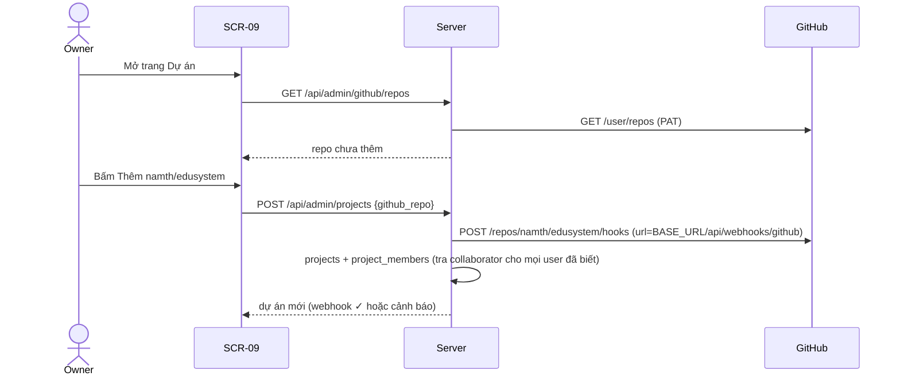

# FEAT-04: Đa dự án song song

> Trạng thái: SPEC_APPROVED (2026-11-04) · Quyết định: DEC-14, DEC-15, DEC-16, DEC-17

## 1. Tổng quan & mục tiêu nghiệp vụ
Một AgentHub quản lý nhiều repo GitHub cùng owner (`namth`). Mỗi repo là một **dự án**: Kanban, task, issue, PR, webhook riêng; dàn máy và trưởng phòng dùng chung, chia việc công bằng giữa các dự án.

## 2. Phân quyền
| Hành động | Quản trị hệ thống (owner) | ADMIN dự án | PARTNER dự án | Không là thành viên |
| :--- | :---: | :---: | :---: | :---: |
| Xem danh sách dự án mình thấy (`GET /api/projects`) | tất cả | ✅ | ✅ | ❌ (không hiện) |
| Thêm / sửa / lưu trữ dự án (SCR-09) | ✅ | ❌ | ❌ | ❌ |
| Kanban, tạo yêu cầu trong dự án | ✅ | ✅ | ✅ | 403 |
| Duyệt / từ chối / merge trong dự án | ✅ | ✅ | ❌ | 403 |
| Gán dự án cho agent | ✅ (mọi máy) | — | máy của mình (FEAT-05) | — |

- Quản trị hệ thống = tài khoản GitHub có `login` trùng `GITHUB_OWNER` (DEC-17).
- Vai trong dự án tra quyền collaborator trên đúng repo theo DEC-09 (`admin|maintain` → ADMIN, còn lại → PARTNER), làm mới khi đăng nhập và khi thêm dự án; lưu `project_members`.

## 3. Luồng tương tác

Khi agent xin việc: dispatcher chọn job theo DEC-16 → `ASSIGN_TASK.payload.repo = "namth/edusystem"` → runner dùng bản clone `~/.agenthub/repos/namth/edusystem` (tự clone lần đầu) → worktree → làm như cũ.

## 4. Giao diện & 4 trạng thái UI
- **Sidebar:** ô chọn dự án (lưu lựa chọn trong `localStorage`); owner có "Tất cả dự án". Mục quản trị (Dự án, Cụm máy, Văn phòng, Cài đặt) chỉ owner thấy.
- **SCR-02 Kanban / SCR-03 Tạo yêu cầu / SCR-04:** theo dự án đang chọn; thẻ ghi tên repo khi xem "Tất cả".
- **SCR-09 Dự án** (`/projects`, `src/pages/Projects.tsx`, chỉ owner): bảng dự án (repo, nhánh mặc định, webhook ✓/⚠, số task đang mở, `weight`, `max_parallel`, nút Lưu trữ) + bảng "Repo chưa thêm" với nút Thêm. 4 trạng thái: tải (skeleton), rỗng ("Chưa có dự án" + danh sách repo), lỗi (banner + Thử lại; PAT thiếu quyền → thông báo rõ quyền cần cấp), thành công.
- **SCR-05 Cụm máy:** mỗi agent có ô chọn dự án được nhận (mặc định "Mọi dự án").
- Validate: `weight` 1–5; `max_parallel` 1–50 hoặc trống.

## 5. Tác động dữ liệu (migration `002_multi_project.sql`)
```sql
ALTER TABLE projects ADD COLUMN weight INTEGER NOT NULL DEFAULT 1 CHECK(weight BETWEEN 1 AND 5);
ALTER TABLE projects ADD COLUMN max_parallel INTEGER CHECK(max_parallel BETWEEN 1 AND 50);
ALTER TABLE projects ADD COLUMN webhook_id INTEGER;
CREATE TABLE project_members (
    project_id TEXT NOT NULL REFERENCES projects(id) ON DELETE CASCADE,
    user_id TEXT NOT NULL REFERENCES users(id) ON DELETE CASCADE,
    role TEXT NOT NULL CHECK(role IN ('ADMIN','PARTNER')),
    synced_at DATETIME,
    PRIMARY KEY (project_id, user_id)
);
CREATE TABLE agent_projects (
    agent_id TEXT NOT NULL REFERENCES agents(id) ON DELETE CASCADE,
    project_id TEXT NOT NULL REFERENCES projects(id) ON DELETE CASCADE,
    PRIMARY KEY (agent_id, project_id)
);  -- agent không có dòng nào = nhận mọi dự án
CREATE INDEX idx_jobs_project_status ON jobs(project_id, status);
```
- `projects.status` (`ACTIVE`/`ARCHIVED`) đã có. Dự án `ARCHIVED`: không nhận job mới, Kanban chỉ đọc.
- **Cơ chế migration** (TASK-019): bảng `schema_migrations(version, applied_at)`; `database.Open` chạy lần lượt `migrations/NNN_*.sql` chưa áp dụng, mỗi file trong một transaction. `001_init.sql` = `schema.sql` hiện tại. DB cũ (đã có bảng, chưa có `schema_migrations`) được đánh dấu `001` rồi chạy tiếp `002…`.
- Dữ liệu cũ: dự án `namth/agenthub` giữ nguyên; `project_members` điền dần khi người dùng đăng nhập lại.

## 6. Hợp đồng API
| Endpoint | Quyền | Body / tham số | Kết quả |
| :--- | :--- | :--- | :--- |
| `GET /api/projects` | đăng nhập | – | `[{id, github_repo, name, role, status, open_tasks}]` |
| `GET /api/admin/github/repos` | owner | – | `[{full_name, default_branch, private, added}]`; PAT lỗi → 502 `GITHUB_ERROR` |
| `POST /api/admin/projects` | owner | `{github_repo}` | 201 dự án `{…, webhook_ok}`; đã có → 409 `CONFLICT`; PAT không thấy repo → 404 |
| `PATCH /api/admin/projects/{id}` | owner | `{weight?, max_parallel?, status?}` | 200; sai miền → 400 |
| `GET /api/tasks?project_id=` | thành viên | `project_id` bắt buộc trừ owner | như cũ; không là thành viên → 403 |
| `POST /api/tasks` | thành viên | `{project_id, title, description}` | như cũ, issue tạo đúng repo |
| `POST /api/tasks/{id}/approve|reject|merge` | ADMIN dự án | – | như cũ, kiểm vai theo dự án của task |
| `PATCH /api/admin/agents/{id}` | owner | thêm `projects: [id] | null` | 200 |
| `POST /api/webhooks/github` | HMAC | – | định tuyến theo `repository.full_name`; repo không quản lý → 202 bỏ qua |
| WS `ASSIGN_TASK.payload` | – | thêm `repo` | `"namth/edusystem"` |

## 7. Quy tắc nghiệp vụ
| Mã | Quy tắc |
| :--- | :--- |
| **BR-24** | Mọi task/job thuộc đúng một dự án; GitHub client (issue, nhãn, merge) tạo theo `projects.github_repo` của task. |
| **BR-25** | Chọn job: `lead_only` (lead) → `priority` → dự án có `RUNNING/weight` nhỏ nhất → `created_at`; bỏ dự án `ARCHIVED`, dự án đã đủ `max_parallel`, dự án ngoài `agent_projects` của agent (DEC-16). |
| **BR-26** | Thêm dự án: tạo webhook thất bại vẫn lưu dự án, `webhook_id = NULL`, SCR-09 hiện ⚠ và nút "Tạo lại webhook". |
| **BR-27** | Vai dự án làm mới khi đăng nhập (tra mọi dự án ACTIVE) và khi thêm dự án (tra mọi user đã biết); không là collaborator → xoá khỏi `project_members`. |
| **BR-28** | Runner: thiếu bản clone repo → `git clone https://github.com/<repo>.git` vào `~/.agenthub/repos/<repo>`; clone lỗi → `LOG_CHUNK [runner] clone …` và không nộp (UNBLOCK lo). |
| **BR-29** | Trưởng phòng vẫn là một cho toàn hệ thống; prompt job lead nạp bối cảnh của dự án liên quan. |

## 8. Test case
| Mã | Kịch bản | Kỳ vọng |
| :--- | :--- | :--- |
| TC-36 | Migration trên DB cũ (đã có bảng, chưa có `schema_migrations`) | Đánh dấu 001, chạy 002, dữ liệu cũ còn nguyên |
| TC-37 | Migration chạy lại | Không lỗi, không chạy trùng |
| TC-38 | Partner không là collaborator gọi Kanban dự án B | 403 |
| TC-39 | Thêm dự án: webhook tạo được / lỗi | `webhook_ok` true / false + vẫn lưu |
| TC-40 | Webhook từ repo không quản lý | 202, không ghi gì |
| TC-41 | 2 dự án weight 1 và 2, mỗi dự án 10 job, 6 agent | Phân chia ≈ 2 : 4 |
| TC-42 | `max_parallel = 1` | Không bao giờ quá 1 job RUNNING của dự án đó |
| TC-43 | Agent gán chỉ dự án A | Không nhận job dự án B |
| TC-44 | Runner nhận job repo chưa có | Tự clone, worktree đúng repo, push đúng remote |
| TC-45 | Tạo task dự án B | Issue tạo trên repo B |

## 9. Task triển khai & DoD
| Task | Nội dung | DoD |
| :--- | :--- | :--- |
| **TASK-019** | Cơ chế migration + `002_multi_project.sql` | TC-36, TC-37; mọi test cũ xanh |
| **TASK-020** | Package `internal/projects`: liệt kê repo, thêm dự án + webhook, `project_members`, API dự án; auth chế độ đa dự án | TC-38 (API), TC-39 |
| **TASK-026** | Tasks / pipeline / webhook GitHub theo dự án (GitHub client theo repo của task, vai theo dự án) | TC-38, TC-40, TC-45 |
| **TASK-027** | Dispatcher: chia lượt theo weight, `max_parallel`, `agent_projects`, máy tạm dừng, `lead_eligible` | TC-41 → TC-43, TC-51, TC-53 |
| **TASK-021** | Runner đa repo (`payload.repo`, clone cache, bỏ `--repo`) | TC-44; test runner cũ xanh |
| **TASK-022** | UI: ô chọn dự án, SCR-09, Kanban/Tạo yêu cầu theo dự án, gán dự án cho agent | vitest + typecheck + build |
| **TASK-028** | API bổ sung cho UI: `GET /api/fleet` (chủ máy, phiên bản, paused, `lead_eligible`, dự án agent, dự án của việc đang chạy), `PATCH /api/admin/agents/{id}` nhận `lead_eligible`/`projects`, `open_tasks`, `POST /api/admin/projects/{id}/webhook` | test Go `internal/api`, `internal/projects` |
