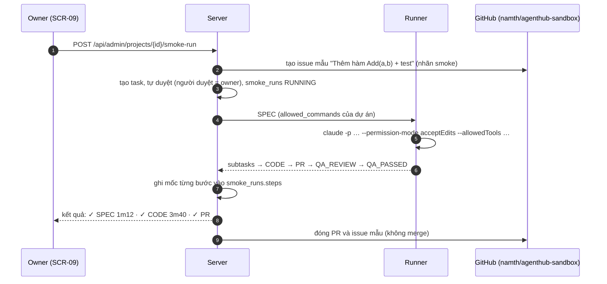

# FEAT-09: Vận hành thật & an toàn đa partner

> Trạng thái: SPEC_APPROVED (2026-11-04) · Quyết định: DEC-34, DEC-35, DEC-36, DEC-37, DEC-38

## 1. Tổng quan & mục tiêu nghiệp vụ

**Bài toán (phát hiện khi triển khai f67a047/8f7534e):**
- Chưa từng chạy trọn một yêu cầu thật; test chỉ là unit/integration với CLI giả.
- CLI chạy không tương tác (`claude -p`, `agy -p`) không có quyền ghi file/chạy `git`, `gh`, test → job SPEC/CODE/QA có thể luôn thất bại.
- `claude auth status` báo `loggedIn: true` trong khi gọi thật lỗi "OAuth session expired" → FEAT-06 bị đánh lừa.
- Máy partner mới nối không có dòng `agent_projects` = nhận việc **mọi dự án**, kể cả repo partner không phải thành viên (`internal/dispatcher/service.go`, điều kiện `NOT EXISTS agent_projects`).

**Mục tiêu:** dây chuyền chạy được trên máy thật với quyền tối thiểu; phát hiện mất đăng nhập đúng; máy partner chỉ chạm dự án của mình; có nút chạy thử trọn dây chuyền sau mỗi lần triển khai hoặc thêm máy.

**Ngoài phạm vi:** chạy CLI trong container; cấp secret cho máy partner (DEC-38).

## 2. Phân quyền

| Hành động | Owner | ADMIN dự án | PARTNER |
| :--- | :---: | :---: | :---: |
| Sửa allowlist lệnh của dự án (SCR-09) | ✅ | ❌ | ❌ |
| Bấm "Chạy thử dây chuyền" (dự án sandbox) | ✅ | ❌ | ❌ |
| Xem kết quả chạy thử | ✅ | ❌ | ❌ |
| Máy của mình nhận việc dự án | — | dự án mình là thành viên | dự án mình là thành viên |

## 3. Luồng tương tác



## 4. Giao diện & 4 trạng thái UI

**SCR-09 Dự án — mở rộng mỗi dự án:**
- **Lệnh được phép** (textarea, mỗi dòng một tiền tố lệnh, vd `go test`, `gofmt`, `npm ci`, `npx vitest`). Hiển thị kèm danh sách mặc định chỉ đọc: `git`, `gh pr create`, `gh pr view`, `ls`, `cat`, `grep`, `find`, `head`, `tail`, `wc`. Validate: ≤ 40 dòng, mỗi dòng `^[a-zA-Z0-9_./ -]{1,60}$`, cấm `sudo`, `rm -rf /`, `curl|sh`, `*` đứng một mình.
- Công tắc **"Cần CI cho test tích hợp"** (ghi chú cho agent: không cố chạy test cần secret; dựa vào CI gate).
- Dự án có `is_sandbox = 1`: nút **Chạy thử dây chuyền** + bảng 5 lần chạy gần nhất (thời điểm, máy/agent từng bước, kết quả, thời gian).

**SCR-11 Máy của tôi:** ô chọn dự án chỉ liệt kê dự án mình là thành viên (đã có); thêm dòng chú thích "Không chọn = mọi dự án bạn tham gia".

| Trạng thái (chạy thử) | Hiển thị |
| :--- | :--- |
| **Empty** | "Chưa chạy thử lần nào" + nút. |
| **Loading** | Dòng tiến trình từng bước cập nhật mỗi 3 giây (`GET …/smoke-runs/{run}`); nút disabled khi đang chạy. |
| **Error** | Bước lỗi màu đỏ + 20 dòng log cuối + gợi ý (vd "agent NEEDS_AUTH", "lệnh bị chặn: go test — thêm vào allowlist"). Quá 30 phút → `TIMEOUT`. |
| **Success** | Mọi bước ✓ kèm thời gian; liên kết PR mẫu (đã đóng). |

## 5. Tác động dữ liệu (trong `005_ops_remote.sql`)

```sql
ALTER TABLE projects ADD COLUMN allowed_commands TEXT;          -- JSON array tiền tố lệnh riêng dự án
ALTER TABLE projects ADD COLUMN needs_ci_for_integration INTEGER NOT NULL DEFAULT 0;
ALTER TABLE projects ADD COLUMN is_sandbox INTEGER NOT NULL DEFAULT 0;

CREATE TABLE IF NOT EXISTS smoke_runs (
    id TEXT PRIMARY KEY,
    project_id TEXT NOT NULL REFERENCES projects(id) ON DELETE CASCADE,
    task_id TEXT REFERENCES tasks(id) ON DELETE SET NULL,
    status TEXT NOT NULL CHECK(status IN ('RUNNING','PASSED','FAILED','TIMEOUT')),
    steps TEXT NOT NULL DEFAULT '[]',     -- JSON [{step, agent_id, started_at, ended_at, ok, note}]
    started_by TEXT REFERENCES users(id),
    started_at DATETIME DEFAULT CURRENT_TIMESTAMP,
    ended_at DATETIME
);
```

## 6. Hợp đồng API

| Endpoint / bản tin | Quyền | Mô tả | Lỗi |
| :--- | :--- | :--- | :--- |
| `PATCH /api/admin/projects/{id}` | owner | thêm `allowed_commands` (mảng), `needs_ci_for_integration`, `is_sandbox` | `400 VALIDATION_ERROR` |
| `POST /api/admin/projects/{id}/smoke-run` | owner | chỉ dự án `is_sandbox`; `202 {run_id}` | `409 CONFLICT` (đang có lần chạy) · `400` (không phải sandbox) |
| `GET /api/admin/projects/{id}/smoke-runs` / `GET /api/admin/projects/{id}/smoke-runs/{run}` | owner | danh sách 5 lần gần nhất / chi tiết | `404` |
| WS `ASSIGN_TASK.payload.allowed_commands` | — | mặc định + riêng dự án (đã gộp, không trùng) | — |
| WS `ASSIGN_TASK.payload.needs_ci` | — | bool, runner thêm vào prompt | — |

**Runner dựng lệnh CLI** (không bao giờ dùng chế độ bỏ qua quyền):
```
claude -p "<prompt>" --permission-mode acceptEdits --allowedTools "Bash(git:*)" "Bash(gh pr create:*)" "Bash(go test:*)" … "Read" "Edit" "Write" "Glob" "Grep"
agy  : viết allow-rule tạm cho worktree (settings của agy trong thư mục tạm của assignment) gồm command(<tiền tố>) tương ứng, xoá sau job
```

## 7. Quy tắc nghiệp vụ

| Mã | Quy tắc |
| :--- | :--- |
| **BR-56** | Allowlist hiệu lực = mặc định hệ thống ∪ `projects.allowed_commands`. Runner chỉ cấp đúng tập này cho CLI của job; lệnh ngoài tập bị CLI từ chối → agent ghi vào log; job lỗi do "lệnh bị chặn" được gợi ý trên SCR-09. Không có đường nào bật chế độ bỏ qua quyền. |
| **BR-57** | Kiểm đăng nhập "thật": lúc bắt tay và 6 giờ/lần khi agent rảnh, runner chạy một prompt cực ngắn (`-p "Trả lời đúng một từ: OK"`, timeout 60s) cho agent có `probe_prompt`; lỗi khớp `auth_patterns` → `NEEDS_AUTH`; thành công → `OK`. Bổ sung `auth_patterns` mặc định: `failed to authenticate`, `oauth`, `session expired`, `token expired`, `could not be refreshed`. |
| **BR-58** | Máy có `owner_user_id` là partner chỉ nhận job của dự án mà chủ máy có trong `project_members` (lọc cứng trong `RequestJob`, cộng với `agent_projects` nếu có). Chủ máy mất tư cách thành viên → assignment ACTIVE của máy đó ở dự án ấy `RECLAIMED` (không tăng attempt). Máy owner/hệ thống giữ quy tắc cũ. |
| **BR-59** | Không gửi secret tới runner. `needs_ci_for_integration = 1` → prompt dặn agent không chạy test cần secret, dựa vào CI gate (TASK-09); QA không đánh `CHANGES` vì thiếu secret. |
| **BR-60** | Chạy thử chỉ trên dự án `is_sandbox`; mỗi dự án tối đa 1 lần chạy cùng lúc; tối đa 30 phút; xong (đạt hay không) đóng PR + issue mẫu, không merge; job của lần chạy có `priority = 50` (chen trước việc thường). |

## 8. Test case

| Mã | Loại | Kịch bản | Kỳ vọng |
| :--- | :--- | :--- | :--- |
| **TC-83** | Runner | Job CODE với allowlist `[go test, gofmt]` | `exec` nhận `claude -p … --permission-mode acceptEdits --allowedTools` đúng thứ tự, có `Bash(go test:*)`, **không** có `--dangerously-skip-permissions` hay `bypassPermissions` |
| **TC-84** | Runner | agy job | tạo file allow-rule tạm chứa đúng tiền tố, xoá sau job (cả khi lỗi) |
| **TC-85** | Runner | Probe thật: CLI giả trả "Failed to authenticate. OAuth session expired" | `AGENT_AUTH NEEDS_AUTH`; probe OK → `OK`; chạy lại sau 6 giờ (đồng hồ giả) |
| **TC-86** | Dispatcher | Máy partner (thành viên p1, không p2), job p2 QUEUED | Không nhận job p2; nhận job p1 |
| **TC-87** | Dispatcher | Partner bị gỡ khỏi p1 khi máy đang chạy job p1 | Assignment `RECLAIMED`, attempt giữ nguyên, job về hàng đợi |
| **TC-88** | API | PATCH allowlist có `sudo`, 41 dòng, ký tự lạ | `400 VALIDATION_ERROR` |
| **TC-89** | Integration | Chạy thử với runner giả đi đủ SPEC → CODE → QA PASS; lần 2 khi lần 1 chưa xong | `PASSED`, 4 bước có thời gian, PR/issue mẫu được đóng; lần 2 `409` |

## 9. Task triển khai & DoD

| Task | Nội dung | DoD |
| :--- | :--- | :--- |
| **TASK-041** | Allowlist: API + validate (projects), gộp vào `ASSIGN_TASK`, runner dựng cờ claude/agy | TC-83, TC-84, TC-88 |
| **TASK-042** | Runner: probe thật + mẫu lỗi OAuth | TC-85 |
| **TASK-043** | Dispatcher: lọc máy partner theo `project_members`, thu hồi khi mất tư cách | TC-86, TC-87 + test dispatcher cũ xanh |
| **TASK-044** | Chạy thử dây chuyền: `smoke_runs`, API, theo dõi từng bước, đóng PR/issue; SCR-09 nút + bảng | TC-89 + vitest SCR-09 |

**Vận hành sau deploy (docs/15 / deploy/README):** tạo repo `namth/agenthub-sandbox` (Go module tối thiểu + `go test`), thêm làm dự án, bật `is_sandbox`, khai allowlist `go test`, `gofmt`, bấm Chạy thử.
