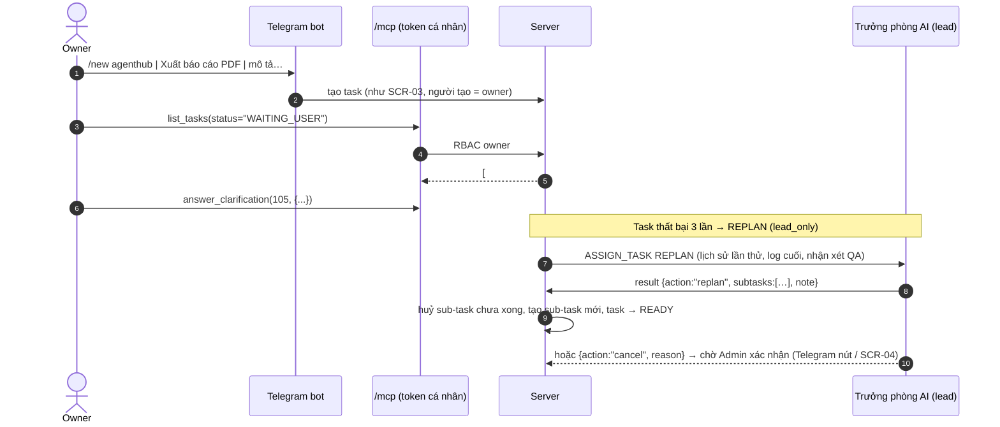

# FEAT-10: Điều hành từ mọi nơi (Telegram, MCP, điện thoại) & trưởng phòng AI xử lý kẹt

> Trạng thái: SPEC_APPROVED (2026-11-04) · Quyết định: DEC-39, DEC-40

## 1. Tổng quan & mục tiêu nghiệp vụ

**Bài toán:** Owner điều hành phòng IT phân tán nhưng mới chỉ làm được đầy đủ trên web máy tính. Telegram chỉ có duyệt; không merge, không xem tiến độ, không tạo yêu cầu. Claude Code trên máy local không có cách giao việc/xem tình hình AgentHub. Trưởng phòng AI nhận `REPLAN`/`UNBLOCK` nhưng kết quả bị bỏ qua (`OnSubmitted` không xử lý) → `Reconcile` làm lại SPEC từ đầu.

**Mục tiêu:**
1. Owner làm trọn vòng (tạo → duyệt → trả lời làm rõ → xem tiến độ → merge) từ **Telegram**, **Claude Code / Claude app qua MCP**, hoặc **web trên điện thoại**.
2. Trưởng phòng AI có quyền hành động có kiểm soát khi task kẹt: thử lại kèm hướng dẫn, lập lại kế hoạch, hỏi người dùng, đề xuất huỷ.

**Ngoài phạm vi (DEC-39):** partner dùng Telegram hoặc MCP — partner chỉ dùng web ở đợt này.

## 2. Phân quyền

| Hành động | Owner | ADMIN dự án | PARTNER |
| :--- | :---: | :---: | :---: |
| Lệnh bot Telegram (`/new`, `/status`, `/tasks`, Duyệt, Merge, trả lời làm rõ) | ✅ (chat `TELEGRAM_ADMIN_CHAT_ID`) | ❌ | ❌ |
| Tạo / thu hồi token cá nhân (SCR-12) | ✅ | ❌ | ❌ |
| Gọi `/mcp` | ✅ (token cá nhân) | ❌ | ❌ |
| Xác nhận đề xuất huỷ của trưởng phòng AI | ✅ | ✅ dự án mình | ❌ |
| Dùng web trên điện thoại | ✅ | ✅ | ✅ |

## 3. Luồng tương tác



## 4. Giao diện & 4 trạng thái UI

**SCR-12 "Hồ sơ"** (`/profile`, `src/pages/Profile.tsx`, mọi người dùng; phần token chỉ owner): thông tin GitHub; **Token cá nhân**: danh sách (tên, tạo lúc, dùng lần cuối, 4 ký tự cuối), nút **Tạo token** (đặt tên, hết hạn 30/90/365 ngày) → hiện token **một lần** kèm nút Sao chép và đoạn cấu hình MCP mẫu; nút **Thu hồi** (xác nhận).
```
claude mcp add --transport http agenthub https://agent.oa.io.vn/mcp --header "Authorization: Bearer <token>"
```

**Web trên điện thoại (≥ 375px):** sidebar thành menu trượt; SCR-02 cột cuộn ngang theo cột, thẻ đủ nút Duyệt; SCR-04 nút Duyệt / Merge / tab Làm rõ dùng được bằng ngón tay (vùng bấm ≥ 44px); SCR-11 bảng thành thẻ; SCR-08 canvas cuộn ngang, thanh trạng thái cố định dưới.

**SCR-04:** đề xuất huỷ của trưởng phòng AI hiện băng "Trưởng phòng đề xuất huỷ: <lý do>" + nút **Đồng ý huỷ** / **Từ chối** (ADMIN).

| Trạng thái (SCR-12 token) | Hiển thị |
| :--- | :--- |
| **Empty** | "Chưa có token" + nút Tạo token + hướng dẫn MCP. |
| **Loading** | Skeleton danh sách; nút Tạo "Đang tạo…". |
| **Error** | Băng đỏ + Thử lại; tên trùng → lỗi tại ô. |
| **Success** | Token mới hiện một lần, cảnh báo "sẽ không hiển thị lại". |

## 5. Tác động dữ liệu (trong `005_ops_remote.sql`)

```sql
CREATE TABLE IF NOT EXISTS personal_tokens (
    id TEXT PRIMARY KEY,
    user_id TEXT NOT NULL REFERENCES users(id) ON DELETE CASCADE,
    name TEXT NOT NULL,
    token_hash TEXT NOT NULL UNIQUE,        -- SHA-256, không lưu token gốc
    last4 TEXT NOT NULL,
    expires_at DATETIME NOT NULL,
    last_used_at DATETIME,
    revoked_at DATETIME,
    created_at DATETIME DEFAULT CURRENT_TIMESTAMP,
    UNIQUE(user_id, name)
);
CREATE TABLE IF NOT EXISTS lead_proposals (                -- đề xuất huỷ chờ Admin
    id TEXT PRIMARY KEY,
    task_id TEXT NOT NULL REFERENCES tasks(id) ON DELETE CASCADE,
    kind TEXT NOT NULL CHECK(kind IN ('CANCEL')),
    reason TEXT NOT NULL,
    proposed_by TEXT NOT NULL,                             -- agent_id
    epoch INTEGER NOT NULL,
    status TEXT NOT NULL DEFAULT 'PENDING' CHECK(status IN ('PENDING','ACCEPTED','REJECTED')),
    decided_by TEXT REFERENCES users(id),
    created_at DATETIME DEFAULT CURRENT_TIMESTAMP,
    decided_at DATETIME
);
```

## 6. Hợp đồng API

| Endpoint | Quyền | Mô tả | Lỗi |
| :--- | :--- | :--- | :--- |
| `GET /api/me/tokens` · `POST /api/me/tokens` · `DELETE /api/me/tokens/{id}` | owner | `POST {name, expires_days: 30\|90\|365}` → `201 {id, token, last4, expires_at}` (token chỉ trả lần này) | `400` · `403` · `409 CONFLICT` (trùng tên) |
| `POST /mcp` (MCP Streamable HTTP, JSON-RPC 2.0) | `Authorization: Bearer <token cá nhân>` của owner | tools bên dưới; mỗi tool chạy với đúng RBAC của người sở hữu token | `401` (thiếu/sai/hết hạn/thu hồi) · `403` |
| `POST /api/tasks/{id}/proposals/{pid}/accept` · `…/reject` | owner, ADMIN dự án | xác nhận / từ chối đề xuất huỷ | `403` · `409` |

**MCP tools** (tên · tham số · kết quả):
- `create_task(project, title, description)` → `{id, status}` (cùng validate SCR-03)
- `list_tasks(project?, status?, limit≤50)` → thẻ rút gọn kèm nhãn "Cần làm rõ"
- `task_status(id)` → trạng thái, sub-task, PR, vòng làm rõ, job đang chạy, log 20 dòng cuối (đã che secret)
- `answer_clarification(id, answers)` → như `POST /api/tasks/{id}/clarify` (kênh `MCP`)
- `approve_task(id)` · `merge_task(id)` · `decide_proposal(task_id, proposal_id, accept)`
- `fleet_status()` → máy, agent, `auth_status`, lead, việc đang chạy

**Telegram (chỉ chat owner):** `/new <dự án> | <tiêu đề> | <mô tả>`, `/tasks [dự án]`, `/status <id>`; tin có nút **Duyệt**, **Merge** (khi `QA_PASSED`), **Đồng ý huỷ / Từ chối**, nút phương án làm rõ (FEAT-07).

**`result.json` của `REPLAN` / `UNBLOCK`:**
```json
{ "action": "retry",   "note": "Dùng testify, chạy go test ./internal/x" }
{ "action": "replan",  "note": "…", "subtasks": [ {"title": "…", "description": "…", "dod": "…"} ] }
{ "action": "ask_user","questions": [ /* như NEED_INFO */ ] }
{ "action": "cancel",  "reason": "Yêu cầu trùng #98" }
```

## 7. Quy tắc nghiệp vụ

| Mã | Quy tắc |
| :--- | :--- |
| **BR-61** | Bot chỉ nhận lệnh từ `TELEGRAM_ADMIN_CHAT_ID`; tin từ chat khác bị bỏ qua (không trả lời). Lệnh thực hiện với danh tính owner, cùng service với web (không đường tắt bỏ RBAC/validate). |
| **BR-62** | Token cá nhân: 32 byte `crypto/rand`, tiền tố `ahp_`, lưu SHA-256; hết hạn bắt buộc (≤ 365 ngày); tối đa 10 token còn hiệu lực/người; `last_used_at` ghi tối đa 1 lần/phút. Token không dùng được cho cookie web hay WebSocket runner. |
| **BR-63** | `/mcp` đợt này chỉ chấp nhận token của owner (DEC-39); mọi tool đi qua cùng service/RBAC với REST; giới hạn 60 lời gọi/phút/token (`429`). Nội dung trả về đã qua bộ che secret (BR-20). |
| **BR-64** | `REPLAN`/`UNBLOCK` (job `lead_only`, fencing `epoch`): `retry` → ghi `note` vào `lead_journal`, job CODE mới cùng nhánh, `attempt` về 1; `replan` → sub-task chưa `DONE` chuyển `REJECTED` (đóng issue con kèm lý do), tạo sub-task mới như SPEC, task cha `READY`; `ask_user` → như `NEED_INFO` (FEAT-07); `cancel` → tạo `lead_proposals` PENDING, báo owner, **không** tự huỷ. Kết quả sai schema → giữ hành vi cũ (Telegram báo owner, không lặp REPLAN quá 2 lần cho cùng task trong 24h). |
| **BR-65** | Giao diện điện thoại: mọi thao tác chính (duyệt, trả lời, merge, xác nhận đề xuất, tạm dừng máy) dùng được ở 375×667 không cần cuộn ngang trang (trừ Kanban và văn phòng cuộn trong khung). |

## 8. Test case

| Mã | Loại | Kịch bản | Kỳ vọng |
| :--- | :--- | :--- | :--- |
| **TC-90** | Telegram | `/new agenthub \| Xuất PDF \| mô tả đủ dài` từ chat owner; cùng lệnh từ chat lạ; `/new` sai cú pháp | Task tạo với người tạo = owner; chat lạ bị bỏ qua; sai cú pháp → tin hướng dẫn |
| **TC-91** | Telegram | Nút Merge khi `QA_PASSED`; khi chưa | Merge gọi đúng service; chưa đủ điều kiện → tin lỗi, không merge |
| **TC-92** | Security | Token: tạo, dùng, thu hồi, hết hạn, token partner, token sai | Chỉ trả token 1 lần; DB chỉ có hash; `401` sau thu hồi/hết hạn; partner `403` khi tạo |
| **TC-93** | MCP | `tools/list`, `create_task`, `list_tasks`, `answer_clarification`, `merge_task` với token owner; 61 lời gọi/phút | Kết quả khớp REST; lời gọi 61 → `429` |
| **TC-94** | Pipeline | REPLAN trả `retry` / `replan` / `ask_user` / `cancel` / sai schema 3 lần | Đúng hành vi BR-64; `cancel` tạo proposal PENDING, task không đổi; sai schema không lặp quá 2 lần/24h |
| **TC-95** | API | Accept/Reject proposal bởi ADMIN / PARTNER | Accept → task `REJECTED` + đóng issue; PARTNER `403` |
| **TC-96** | UI | 375×667: Kanban, TaskDetail (duyệt, làm rõ, merge, proposal), MyMachines, Profile | vitest (matchMedia giả) + ảnh chụp Playwright trong báo cáo nghiệm thu; không có tràn ngang `document.scrollWidth ≤ 375` |

## 9. Task triển khai & DoD

| Task | Nội dung | DoD |
| :--- | :--- | :--- |
| **TASK-045** | Telegram: lệnh `/new`, `/tasks`, `/status`, nút Merge, đề xuất huỷ, nút làm rõ | TC-90, TC-91 |
| **TASK-046** | Token cá nhân + `/mcp` (Streamable HTTP, JSON-RPC) + SCR-12 Hồ sơ | TC-92, TC-93 + vitest SCR-12 |
| **TASK-047** | Web responsive 375px (AppShell menu trượt, SCR-02/04/08/11/12) | TC-96 |
| **TASK-048** | Pipeline REPLAN/UNBLOCK hành động + `lead_proposals` + API/SCR-04 xác nhận | TC-94, TC-95 |
