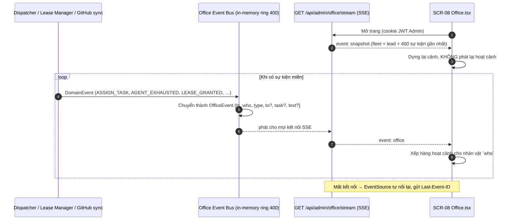

# FEAT-02: Văn phòng ảo (Sơ đồ phối hợp trực quan)

> Quyết định liên quan: DEC-07, DEC-08 (`docs/14-decisions.md`). Nguồn tham khảo: `namth/edusystem`, nhánh `claude/office-simulation-gui-ca46c2`, thư mục `office/` (đọc `office/README.md`).

## 1. Tổng quan & mục tiêu nghiệp vụ

**Bài toán:** Bảng Fleet (SCR-05) cho biết *trạng thái*, nhưng khó cảm nhận *sự phối hợp*: ai đang giao việc cho ai, ai vừa nghỉ, lead vừa đổi sang máy nào.

**Mục tiêu:** Một màn hình tuỳ chọn vẽ văn phòng pixel-art sống, nhìn là hiểu dây chuyền đang chạy ra sao. **Chỉ quan sát**, không điều khiển; không có chế độ mô phỏng/demo — chỉ vẽ việc thật (DEC-08).

**Khác văn phòng ảo cũ (edusystem):**
| Văn phòng cũ | Văn phòng AgentHub |
| :--- | :--- |
| 4 nhân vật cố định (giám đốc, trưởng phòng, agy1, agy2), toạ độ bàn viết cứng | Bố cục sinh từ dữ liệu: N máy × M agent |
| Nguồn: hook Claude, `state.json`, SSH sang máy thợ, `remote_agent.py` | Nguồn: sự kiện miền của server AgentHub (đã biết mọi thứ) |
| Trưởng phòng là một người cố định | Ghế Trưởng phòng cố định, **người ngồi thay đổi** theo `lead_lease` |
| Không có khái niệm hết limit | Phòng nghỉ cho agent `COOLDOWN` kèm đồng hồ |
| `npm run office`, server Node riêng | Màn hình trong dashboard, nhúng trong single binary |

## 2. Phân quyền

| Hành động | ADMIN | PARTNER | WORKER_AGENT |
| :--- | :---: | :---: | :---: |
| Xem SCR-08 và luồng `GET /api/admin/office/stream` | ✅ | ❌ | ❌ |
| Bật/tắt văn phòng ảo ở SCR-07 | ✅ | ❌ | ❌ |

Chỉ Admin vì màn hình lộ tên máy, việc đang làm, nội dung tóm tắt task — cùng lý do SCR-05/SCR-06 chỉ dành cho Admin.

## 3. Luồng tương tác



### Bảng chuyển sự kiện miền → sự kiện văn phòng

`who`/`to` là `admin` hoặc `agent_id` (vd `mac-mini/claude`); `lead` là bí danh của agent đang giữ lease tại thời điểm phát.

| Sự kiện miền | OfficeEvent | Hoạt cảnh |
| :--- | :--- | :--- |
| Admin duyệt task (web/Telegram) | `{who: admin, type: approve, task}` | Giám đốc đóng dấu hồ sơ; lead vào phòng nhận |
| `ASSIGN_TASK` | `{who: lead, type: assign, to: agent, task}` | Lead mang hồ sơ tới bàn agent (nếu VACANT: hồ sơ tự bay từ "khay việc") |
| Agent bắt đầu làm (`LOG_CHUNK` đầu tiên) | `{who: agent, type: work, task, text}` | Agent gõ phím, màn hình bàn chạy code |
| `TASK_SUBMITTED` | `{who: agent, type: submit, task}` | Agent giơ tay 🙋 |
| Job `QA_REVIEW` bắt đầu | `{who: reviewer, type: review, to: tác giả, task}` | Reviewer cầm bảng kẹp đi tới bàn tác giả, màn hình chạy test |
| QA đạt / cần sửa | `approve` / `reject` (text = lý do) | Kết luận tại bàn rồi về chỗ |
| `AGENT_EXHAUSTED` / chạm hạn mềm | `{who: agent, type: cooldown, text: "đến 21:40"}` | Agent đi vào phòng nghỉ, ☕ + đồng hồ đếm ngược |
| `COOLDOWN → IDLE` | `{who: agent, type: idle}` | Agent rời phòng nghỉ về bàn |
| `LEASE_GRANTED` (đổi người) | `{who: lead cũ, type: handover, to: lead mới}` | Lead cũ (nếu còn ở văn phòng) trao hồ sơ "Trưởng phòng"; lead mới đi tới ghế Trưởng phòng ★ |
| Lease `VACANT` | `{who: system, type: vacant, text: "dự kiến 21:40"}` | Ghế Trưởng phòng trống, biển "Đang tuyển trưởng phòng — 21:40" |
| Máy `OFFLINE` / `ONLINE` | `{who: worker, type: offline/online}` | Cả dãy bàn tắt/bật đèn 📴 |
| Job `REPLAN`/`UNBLOCK` | `{who: lead, type: work, task, text: "Gỡ kẹt #102"}` | Lead đi tới bàn agent đang kẹt rồi về ghế |
| Lỗi job | `{who: agent, type: error, text}` | ⚠️ trên đầu agent |

## 4. Giao diện & 4 trạng thái UI

**SCR-08 "Văn phòng ảo"** — route `/office`, file `src/pages/Office.tsx`, chỉ Admin, mục sidebar "Văn phòng" ngay dưới "Fleet"; **chỉ hiện khi bật** ở SCR-07 (mặc định tắt).

```
┌─ Phòng Giám đốc ─┬─ Ghế Trưởng phòng ★ ──┬─ Phòng nghỉ ───────┐
│  Bạn (Admin)     │  mac-mini/claude       │ laptop/claude      │
│                  │  epoch 7               │ ☕ 41:12           │
├─ Dãy mac-mini ───┼─ Dãy laptop ───────────┼─ Dãy server 📴 ────┤
│ [claude ★][agy]  │ [claude ☕][agy #103]  │ [agy #102]         │
└──────────────────┴────────────────────────┴────────────────────┘
Thanh dưới: Lead · Đang chạy 3 job · Chờ 2 · Nghỉ 1 · [⏸ Tạm dừng hoạt cảnh]
```

- **Bố cục động:** hàng trên cố định (Giám đốc, Ghế Trưởng phòng, Phòng nghỉ, Khay việc); bên dưới là lưới dãy bàn, mỗi máy một dãy, mỗi agent một bàn (màu áo theo `kind`: Claude cam, Antigravity xanh). Thứ tự máy theo tên. Tối đa 8 máy × 16 agent hiển thị đủ; vượt thì lưới cuộn dọc.
- **Nhãn:** di chuột vào nhân vật → tooltip `agent_id`, trạng thái, job hiện tại, `attempt`.
- **Hiệu năng (giữ từ bản cũ):** canvas 384×(272 + 64 × số hàng dãy) phóng to kiểu pixel-art, nền tĩnh vẽ một lần; 12 fps khi có hoạt động, 4 fps khi yên, dừng hẳn khi tab ẩn. Hàng đợi hoạt cảnh mỗi nhân vật tối đa 10 bước, quá thì bỏ bước cũ và nhảy thẳng tới trạng thái mới.

| Trạng thái | Hiển thị |
| :--- | :--- |
| **Empty** | Văn phòng chỉ có phòng Giám đốc và ghế trống; thông điệp "Chưa có máy nào kết nối" + nút "Đăng ký máy" → SCR-05. |
| **Loading** | Khung văn phòng mờ (skeleton) đến khi nhận `snapshot`. |
| **Error** | Mất SSE: băng hổ phách "Mất kết nối — đang thử lại", giữ cảnh cuối, nhân vật đứng yên; 403 → chuyển về SCR-02. |
| **Success** | Văn phòng sống như trên. |

**SCR-07 Cài đặt:** thêm công tắc "Bật văn phòng ảo" (lưu `settings.office_enabled`). Tắt → mục sidebar ẩn, `/office` và `/api/admin/office/stream` trả `404`.

## 5. Tác động dữ liệu

```sql
-- Cài đặt hệ thống dạng key-value (dùng chung cho SCR-07)
CREATE TABLE IF NOT EXISTS settings (
    key TEXT PRIMARY KEY,
    value TEXT NOT NULL,
    updated_at DATETIME DEFAULT CURRENT_TIMESTAMP
);
INSERT OR IGNORE INTO settings (key, value) VALUES ('office_enabled', 'false');
```

Sự kiện văn phòng **không lưu DB**: giữ trong bộ đệm vòng 400 sự kiện trong RAM (~100 KB). Khởi động lại server → văn phòng dựng từ `snapshot` hiện tại, không có lịch sử.

## 6. Hợp đồng API

| Endpoint | Quyền | Mô tả | Lỗi |
| :--- | :--- | :--- | :--- |
| `GET /api/admin/office/stream` | ADMIN | `text/event-stream`. Sự kiện đầu `event: snapshot`, sau đó `event: office`; mỗi sự kiện có `id` tăng dần; hỗ trợ `Last-Event-ID` (còn trong bộ đệm thì gửi bù, không thì gửi `snapshot` mới). Heartbeat comment `: ping` mỗi 20 giây. | `403 FORBIDDEN` · `404 NOT_FOUND` khi tắt |
| `GET /api/admin/settings` | ADMIN | Trả mọi key, gồm `office_enabled` | `403` |
| `PATCH /api/admin/settings` | ADMIN | `{ "office_enabled": true }` | `400 VALIDATION_ERROR` · `403` |

```text
id: 1842
event: office
data: {"ts":"2026-11-03T21:02:11Z","who":"laptop/claude","type":"handover","to":"mac-mini/claude","task":null,"text":"epoch 8"}
```

```json
// event: snapshot
{ "lead": { "state": "HELD", "agent_id": "mac-mini/claude", "epoch": 8 },
  "workers": [ { "id": "mac-mini", "conn_status": "ONLINE",
                 "agents": [ { "id": "mac-mini/claude", "kind": "CLAUDE", "status": "BUSY", "job": { "task": 101, "kind": "SPEC" } } ] } ],
  "recent": [ /* ≤ 400 OfficeEvent */ ] }
```

## 7. Quy tắc nghiệp vụ

| Mã | Quy tắc |
| :--- | :--- |
| **BR-19** | Văn phòng ảo chỉ đọc: SCR-08 không có nút điều khiển nào; mọi thao tác vẫn ở SCR-05/SCR-04. |
| **BR-20** | `text` của OfficeEvent tối đa 80 ký tự, đã loại chuỗi giống secret (token, `ghp_`, `sk-`, khoá dài ≥ 32 ký tự liên tục). Không đưa nội dung log thô hay prompt vào văn phòng. |
| **BR-21** | Khi dựng lại từ `snapshot`, chỉ đặt nhân vật vào vị trí cuối, **không** phát lại hoạt cảnh. |
| **BR-22** | `office_enabled = false` → server không giữ kết nối SSE nào (đóng các kết nối đang mở) và bộ chuyển sự kiện ngừng ghi bộ đệm. |
| **BR-23** | Tối đa 5 kết nối SSE đồng thời; kết nối thứ 6 → `429`. |

## 8. Test case

| Mã | Loại | Kịch bản | Kỳ vọng |
| :--- | :--- | :--- | :--- |
| **TC-28** | Unit | Bộ chuyển nhận từng sự kiện miền trong bảng mục 3 | Ra đúng OfficeEvent (`who`, `type`, `to`) |
| **TC-29** | Unit | `text` chứa `ghp_abc…` hoặc dài 200 ký tự | Bị che và cắt còn ≤ 80 ký tự (BR-20) |
| **TC-30** | Security | Partner gọi `GET /api/admin/office/stream` | `403 FORBIDDEN` |
| **TC-31** | API | `office_enabled = false` rồi gọi stream và `/office` | `404`; bật lại → `200` và nhận `snapshot` |
| **TC-32** | API | Nối lại với `Last-Event-ID` còn trong bộ đệm | Nhận đúng các sự kiện bị lỡ, không trùng |
| **TC-33** | E2E | Bố cục với 1, 3 và 8 máy (dữ liệu seed) | Đủ dãy bàn, không chồng lấn; 8 máy không vỡ khung |
| **TC-34** | E2E | Đổi lead (qua SCR-05) khi đang mở SCR-08 | Nhân vật mới ngồi ghế Trưởng phòng trong < 3 giây |
| **TC-35** | E2E | Agent `COOLDOWN` | Nhân vật ở phòng nghỉ, đồng hồ đếm ngược đúng `cooldown_until` |

## 9. Task triển khai & DoD

| Task | Milestone | Nội dung | DoD / lệnh xác minh |
| :--- | :--- | :--- | :--- |
| **TASK-15** | M4 | `internal/office`: bộ đệm vòng 400, bộ chuyển sự kiện miền, endpoint SSE, bảng `settings` + API | `go test ./internal/office/...` qua TC-28→32 |
| **TASK-16** | M4 | `web/src/pages/Office.tsx`: chuyển canvas từ `office/public/index.html` (edusystem) sang React, thay toạ độ cứng bằng hàm bố cục động, thêm phòng nghỉ, ghế Trưởng phòng, hoạt cảnh handover/vacant/offline | Playwright TC-33→35; 4 trạng thái UI |
| **TASK-17** | M4 | SCR-07: công tắc "Bật văn phòng ảo"; sidebar ẩn/hiện theo cài đặt | Playwright: bật/tắt → mục sidebar và route đổi theo (TC-31) |
